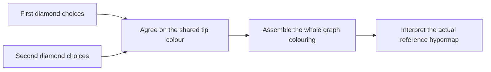
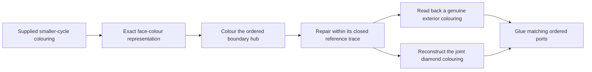
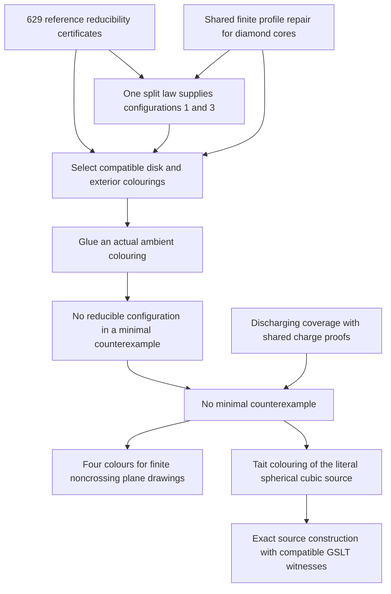

# Compositional Four Colour: proof plan and current results

Updated 2 October 2026. Original complete assembly: `b99eaf006`.
The current assembly additionally consumes a shared joint-profile certificate
for the diamond cores and a general boundary-split law transferring repair from
configuration 2 to configuration 1, and configuration 6 to configuration 3.

The open-piece idea in Goertzel and Fable's compositional note now has a
kernel-checked realization: graph constructions carry actual colouring
witnesses, gluing composes those witnesses, and boundary matrices count them.
A complete classical reconstruction supplies compatible choices for every
bridgeless spherical cubic source map. It also proves four-colourability for
every finite simple graph supplied with a noncrossing drawing in the plane.

The complete proof uses classical reducibility and discharging. The original
proposal to obtain a small generating base from uniform corridor geometry and
finite profiles remains a separate research programme. The present connection
is useful in both directions: the compositional library explains reconstruction,
and the classical proof supplies concrete obligations for further compression.

Start with the [completed theorem][complete], the [integration guide][package],
and the [compression ledger][ledger]. This guide connects them to the original
plan. The [long companion][companion] preserves the detailed development and
earlier attempts; its older sections are historical snapshots.

The latest geometric classification handles both free positions
in the retained six-star. A flat degree-seven first free centre supplies
the existing single-five wheel or a new high neighbour. At a flat degree-seven
second free centre, the
[new theorem](../../../lean/fourcolor-classical/MettapediaFourColor/SecondFanResidual.lean)
gives a further high neighbour, a single-five wheel, or an exact two-five
profile. That last profile spends its entire charge budget: one outer
five-tip and no extra transfers. The geometry is proved independently of
repair. The single-five consumer still requires the full D3009 repair
contract, whose finite checks are being certified separately. All three
two-five wheel separations pass an independent finite repair experiment;
their Lean reconstruction remains open. This narrows the next local
coverage obligation without removing an entry from the unavoidable set.

A completed geometric test concerns two overlapping exceptional neighbourhoods
in the newer catalogue. Their shared rotation forces the D1774 core. Its
[collision alternative](../../../lean/fourcolor-classical/MettapediaFourColor/ExceptionalCoreCollision.lean)
produces an actual nonfacial triangle whenever core injectivity fails. In the
graph-backed minimal regime, the existing three-edge-cut theorem proves that every
such triangle is facial, excluding that branch. The resulting induced core,
eleven-port completion and exact compiled query are checked.

This gives a concrete instance of the construction-or-obstruction approach:
retain the attempted construction, and turn failed identification into a
geometric witness that an existing reduction can exclude. It is not yet a
general theorem for arbitrary triangle construction programs.

The exceptional closing branch is now complete in the graph-backed
vertex-minimal counterexample domain:

```text
aligned exceptional neighbourhoods
    -> actual induced core and joint boundary        proved
    -> cyclic stars and faithful core darts          proved
    -> injective embedded disk                      proved

smaller adjacent-pair cap
    -> colouring from vertex minimality             proved
    -> original conserved field, one zero edge       proved
    -> contract colouring on the same actual dual    proved

contract colouring + D1774 finite repair
    -> compatible exterior and reconstructed colouring
    -> contradiction to minimality                  proved

zero-charge neighbourhood -> reduction or exceptional X
                     classification still open
```

The [local reconstruction](../../../lean/fourcolor-classical/MettapediaFourColor/ExceptionalLocalRepair.lean)
uses one explicit embedding throughout. Different boundary labels may coincide;
the proof retains those identifications while establishing that the off-perimeter
darts are distinct. A general
[kernel-to-disk theorem](../../../lean/fourcolor-classical/MettapediaFourColor/FaithfulKernelEmbedding.lean)
replaces the reference consumer's global Birkhoff-ring and pentagonal hypotheses
with local injectivity and edge reflection of the same kernel map. Complete
cyclic stars and the already proved induced core supply those facts for D1774.

`ExceptionalLocalRepair.overlap_supply` now supplies the specified second
centre and the joint closing law. Classification from zero charge remains an
explicit input; the lower-degree branches, residual alternatives and global
coverage are also open. The actual starting witness uses vertex minimality,
without equating it to reference dart-minimality. D1774 retains its checked
finite repair certificate, and this step removes no additional certificate or
coverage entry. The
[coverage ledger](../../../tools/fourcolor/near-linear/coverage-obligations.json)
and [receipt](../../../tools/fourcolor/near-linear/exceptional-exterior-measurements.json)
record the exact scope.

The remaining classification now has a certified executable foundation.
[Rooted rule traversals](../../../lean/fourcolor-classical/MettapediaFourColor/RuleTraversal.lean)
preserve the same actual occurrence through flips and rotations. All 84 source
rules are reached by 638 checked vertex traces, each using at most seven dart
operations. The [matcher](../../../lean/fourcolor-classical/MettapediaFourColor/RuleMatcher.lean)
checks the resulting candidate's complete degrees, edges and cyclic steps;
Lean proves this check equivalent to an actual rule occurrence, including
possible ambient vertex identifications. Its computed charge equals the
mathematical charge used by the coverage scaffold.

A [replayable program example](../../../tools/fourcolor/near-linear/flat-pair-probe.json)
has two adjacent flat degree-eight centres in a 42-vertex triangulation. A
`D0001` core lies in the union of their radius-two balls but neither ball alone.
Its flatness and that straddling core remain program evidence; other reducible
pieces already occur in the individual balls. The exact rotation and a
different local rule-pair consumer in the same graph are now checked in Lean.

The [joint rule-pair law](#from-interacting-charge-rules-to-an-actual-reduction)
combines rules 003_2 and 004_1 at the same degree-six neighbour. Five known
turns force the sixth, exposing a mixed diamond under a degree-five sender
guard. The actual-map consumer invokes strict reduction and colouring
reconstruction, so this joint profile is forbidden in vertex minimality.
At degree five the same path instead identifies its two outer corners. With
a degree-five remaining corner it gives the pentagonal diamond and a second
strict reduction. Combining both branches proves that a surviving pair with
a degree-five first sender must have shared degree five and remaining-corner
degree six. Finite examples witness both reduction branches. A bound or
classification for the surviving charge profiles is the next obligation.

A subsequent whole-neighbourhood test identifies a case where diamond-only
recognition needs another argument. A concrete flat eight/seven pair has no
mixed or pentagonal diamond core in the union of its radius-two balls, despite
passing the short-cycle obstruction check. It does contain the three-triangle chain `D0004`.
The [checked repair](../../../lean/fourcolor-classical/MettapediaFourColor/NearLinearChainRepair.lean)
transfers from classical configuration 7 through one exact boundary
subdivision; `D0004` needs no separate repair table. Its complete core occurrence
and conditional colouring reconstruction on the example are also checked.
This is the intended feedback between coverage and composition: an actual
remaining profile selects the next piece, and a shared operation supplies its
repair. The
[receipt](../../../tools/fourcolor/near-linear/chain-measurements.json)
records that transfer and its finite example.

The chain now also has an
[actual-map reduction](../../../lean/fourcolor-classical/MettapediaFourColor/ActualChainReduction.lean).
Six Y steps and five H steps construct its exact disk. Five complete cyclic
stars, the core degrees and distinct core vertices give an injective disk
embedding; boundary labels may coincide outside the core. Vertex minimality
supplies the starting singleton contract through the existing strict
two-vertex reduction. The transferred repair and the actual planar exterior
then reconstruct a colouring. No exterior-closure or initial-colouring
hypothesis is left to the caller. The 42-vertex example supplies the geometric
occurrence contract, including the complete rotation, in Lean.

This completes the local consumer for a supplied occurrence. The
[reduction receipt](../../../tools/fourcolor/near-linear/chain-reduction-measurements.json)
retains configuration 7 as the single base certificate and records no change
to the complete assembly's coverage or certificate counts.

Recognition now starts from a short degree word: a degree-six centre with
four consecutive neighbours of degrees `5,6,5,5`. The
[recognition theorem](../../../lean/fourcolor-classical/MettapediaFourColor/ChainFanRecognition.lean)
constructs the three-triangle core, proves it has no identifications or
extra core edges in the minimal domain, and grows the same eight-port
boundary. The complete observation lies within radius two. Its actual
reduction then reconstructs a colouring using the same retained base.
The [recognition receipt](../../../tools/fourcolor/near-linear/chain-recognition-measurements.json)
includes an exact recovery of the retained 42-vertex example. The next
coverage obligation is to derive this degree word or a certified alternative
from every surviving joint charge profile.

A subsequent boundary test shows why the size of the observed neighbourhood
must remain flexible. In a generated 162-vertex triangulation, an adjacent
flat degree-eight/degree-seven pair has neither of the two diamond patterns
nor the chain wholly inside its joint radius-two view. A chain is present
just across that boundary. Its centre is two steps from the degree-eight
vertex; all thirteen reconstructed vertices fit within radius four.

The [continued-rule theorem](../../../lean/fourcolor-classical/MettapediaFourColor/RuleChainRecognition.lean)
extracts the first three chain neighbours from one oriented charge rule.
Their degrees are `5,6,5`; a further degree-five observation completes the
chain around their degree-six centre. The existing strict reduction and
reconstruction therefore exclude this continuation in an actual minimal
counterexample. The same original rule witness bounds the full reconstructed
interface. No new repair certificate is introduced.

The [finite consumer](../../../lean/fourcolor-classical/MettapediaFourColor/ChainBoundaryExample.lean)
checks the rule reading, the continued chain, the crossed observation boundary
and the radius-four bound in Lean. Flat charges, spherical construction,
absence of the known cores in the original joint view, and the short-cycle
conditions have separate [program checks](../../../tools/fourcolor/near-linear/chain-boundary-audit.json).
This excludes a specific rule continuation; coverage of all surviving profiles
remains open. Enlarging the observation view is now a tested option alongside
adding another reduction family.

The [2026 near-linear algorithm](https://arxiv.org/abs/2603.24880) provides an
additional source of family and coverage arguments. The first
[kernel-checked bridge](../../../lean/fourcolor-classical/MettapediaFourColor/NearLinearDiamondRepair.lean)
identifies its catalogue entries `D0000` and `D0001` with our existing diamond
configurations, including their complete embedded graphs and ordered rings.
Relabelling commutes with the same boundary insertion, and both entries inherit
the shared repair rather than new independent rank certificates. The repaired
second-entry witness has a compatible GSLT insertion history. The shared finite
profile remains; the dependency audit excludes all original configuration
certificates and complete Four Colour endpoints.
This establishes reuse across presentations, with no further reduction of the
629 original dependencies or 633 coverage entries in the existing assembly.
The next compression question is whether boundary variations of a larger common
core admit one structural repair law. The newer paper's flat-region coverage
and coordinated Kempe repairs are separate obligations; neither follows from
the two-entry bridge. Source pins, attribution and the exact audit scope are in
the [receipt](../../../tools/fourcolor/near-linear/diamond-measurements.json).

The [shared-tip double diamond](../../../lean/fourcolor-classical/MettapediaFourColor/TwoDiamondConfigurations.lean)
is a direct component example. Configurations 3 and 6 contain two diamonds
sharing one tip. Each piece retains its possible centre and tip colours; one
joint choice identifies the shared tip colour. The resulting equivalence
preserves every constraint on the exterior and reconstructs actual colourings.

For a fixed proper exterior colouring `b`, the component relation is
`R(b) ↔ ∃ c, R_left(b, c) ∧ R_right(b, c)`: both witnesses must use the
same shared tip colour `c`. This is generally a relation between choices,
rather than a unique output for every input. A separate repair law supplies
successful choices from the permitted smaller-graph inputs.



The [GSLT interpretation](../../../lean/fourcolor-classical/MettapediaFourColor/TwoDiamondCompositionGSLT.lean)
proves exact compatible histories through these two operations for both
configurations. Forgetting tip agreement fails on a kernel-checked proper
boundary: the first diamond forces colour 3 and the second forces colour 0.
The [embedded split transfer](../../../lean/fourcolor-classical/MettapediaFourColor/TwoDiamondSplitRepair.lean)
then derives configuration 3's repair from configuration 6's existing base
certificate. The complete endpoint audit excludes configuration 3's original
certificate. Four original dependencies are now replaced, leaving 629;
the 633 coverage entries remain. No additional colouring-rank table is added.
A finite check confirms that the retained configuration 6 base covers every
proper nine-port input; no net saving in primitive checks or artifact size is claimed.

The [actual cubic disk](../../../lean/fourcolor-classical/MettapediaFourColor/TwoDiamondTangle.lean)
now connects this joint witness to configuration 3's twenty cubic vertices,
twenty-six internal edges and eight outgoing ports. Its embedding preserves
the original construction's vertex rotations and internal edge identities.
`joint_construction` proves that the GSLT route and this physical piece use
the same complete witness and boundary trace.

The [cycle replacement](../../../lean/fourcolor-classical/MettapediaFourColor/TwoDiamondCycleReplacement.lean)
replaces these twenty vertices by an eight-cycle with the same ordered ports.
Equal boundary face returns and Euler mass preserve the spherical, cubic,
connected and bridgeless map class in every fixed exterior, including
disconnected exteriors. The complete operation has twelve fewer vertices.
The [hub reconstruction](../../../lean/fourcolor-classical/MettapediaFourColor/TwoDiamondHubColoring.lean)
now proves that every smaller colouring reconstructs, with no extra exterior
closure or connectivity hypothesis. It may recolour the exterior. Geometry
and transport have no configuration-colour-certificate dependency; the repair
retains configuration 6's existing base certificate. This advances the
reconstruction part of the compositional plan while leaving arbitrary-source
recognition and global coverage separate.

The [receipt](../../../tools/fourcolor/classical/two-diamond-cycle-measurements.json)
separates these kernel statements from a bounded program test: all 258 proper
colourings of a literal eight-cycle exterior repair with at most two physical
component switches. That test does not establish closure for arbitrary
exteriors. This geometric step changes neither the 629 original certificates
nor the 633 coverage entries in the complete assembly.

The [exact face/edge bridge](../../../lean/fourcolor-classical/MettapediaFourColor/SourceTaitInverse.lean)
connects this physical construction to the reference's colouring language.
Conservation at every vertex puts both coordinates of a Klein edge field in
the literal cycle space. The spherical facial-boundary theorem supplies face
potentials whose differences recover every original edge colour. The
potentials have only one common colour-shift freedom; fixing one face makes
them unique. The [smaller-map consumer](../../../lean/fourcolor-classical/MettapediaFourColor/TwoDiamondCycleFaceTransport.lean)
preserves both component witnesses and all their shared seam colours through
the round trip. It uses no complete colouring theorem or configuration colour
certificate. This is exact transport of supplied witnesses, not a proof that
arbitrary boundary choices extend.
The [transport receipt](../../../tools/fourcolor/classical/source-tait-inverse-measurements.json)
records the nine-root dependency audit and both passing build gates.

The boundary bridge handles disconnected exteriors. A replayable
24-vertex simple spherical cubic bridgeless map of girth five has this source
disk with two exterior components; its faces are twelve pentagons and two
hexagons. This is independent program evidence against inferring exterior
connectivity from those hypotheses. An exhaustive check of all 8,388,607 vertex
bipartitions finds no cyclic cut below five; all twelve cyclic five-cuts
isolate five vertices. The example is not yet connected to a kernel-checked
decoder.

The general kernel proof instead uses one ordered eight-valent hub:



The hub retains what the repair needs: the joint ordered boundary relation
and witnesses that reconstruct genuine exterior colourings. It preserves
spherical geometry and exterior cofaciality but has an eight-valent vertex;
the actual smaller induction map remains the cubic eight-cycle. The generic
`glue_of_closed_observation` theorem allows a sufficient closed observation
instead of demanding closure of all physical exterior assignments. This is
the successful-choice principle in a concrete consumer.

The [hub audit receipt](../../../tools/fourcolor/classical/two-diamond-hub-measurements.json)
separates this new strict reduction from the unchanged complete-assembly
counts. It uses the reference Kempe theorem and retained configuration-6
repair, not the complete Four Colour theorem. It does not extract a physical
Kempe-move program or give exact colouring counts. The next geometric target
is to recognize this disk from actual source face incidences and transport
the reduction back to that source; universal coverage remains open.

The [actual-occurrence consumer](../../../lean/fourcolor-classical/MettapediaFourColor/TwoDiamondOccurrenceReduction.lean)
now completes the source-transport part. Given an exact identification with
a literal vertex shore, it constructs the actual complementary exterior and
seam, applies the cycle reduction and reconstructs a colouring of the source.
The [generic occurrence adapter](../../../lean/mettapedia/Mettapedia/GraphTheory/FourColor/OpenTangleVertexOccurrence.lean)
proves that reassembly preserves vertices, edge pairs and rotations; every
assembled colouring transports pointwise. The complete operation removes
twelve vertices and excludes such an occurrence from a vertex-minimal
counterexample. It imposes no exterior-connectivity or extra normal-form
hypothesis. Its [audit receipt](../../../tools/fourcolor/classical/two-diamond-occurrence-measurements.json)
retains only the configuration-6 base in repair. The next obligation is to
derive the exact occurrence from useful face incidences, then prove supply
in a justified residual class. No further catalogue entry is removed.

For one complete example, see [ten charge checks from three representatives](reflection-example/README.md):
semantic bounds, a general reflection theorem, and an audited replacement in
the finished proof. It illustrates discharging compression; the diamond example
below now supplies three configuration obligations from a shared finite profile
certificate and a general split transfer.

For a complete example from the corridor idea, see
[compositional reductions for tube families](tube-example/README.md).
The latest [cyclic seam reduction](tube-example/README.md#two-row-deletion-with-a-cyclic-seam-shift)
removes two rows from any recognized tube of at least three rows, at every
width `k ≥ 2`. Rotating the attachment at one end by one port permits genuine colouring
reconstruction and preserves the source map class; exactly `4k` vertices
are removed. The complementary-ring law supplies this result without a new
finite colouring certificate. The earlier width-five exact-support theorem
remains available when preserving the original seam matching in both directions.

The [joint padded-cap law](tube-example/README.md#a-joint-colouring-law-for-padded-cycle-caps)
now yields a second uniform strict reduction: for every even `m ≥ 2`,
replace a literal `8m`-vertex cap by a `2m`-cycle. The smaller map remains
spherical, cubic, connected and bridgeless; every smaller colouring
reconstructs with the entire exterior fixed. A shared cyclic choice law
closes both varying and constant boundary words at even widths. Exact
representation transport excludes recognized members from a least
counterexample, and GSLT composition retains the joint boundary choices.
An independent all-five/six example reduces 96 vertices to 60.
The [coupled physical repair](tube-example/README.md#repairing-a-constant-cap-boundary)
now extends strict reduction to every `m ≥ 2` for exactly recognized caps
with connected exterior. Spherical geometry derives the actual noncrossing
component matching; an adjacent component switch repairs a constant boundary
and its shared cycle edge together. The repaired witnesses reconstruct an
ambient colouring. The exterior may change in this branch, and the GSLT cell
therefore retains the cap and its exterior as one joint witness. An independent
odd-width example reduces 50 vertices to 20. The new
[face-trace recognition](tube-example/README.md#recognizing-caps-from-their-faces)
constructs the exact cap-shore representation from actual face closures,
an injective vertex trace and short seam faces. A uniform reflection law
derives boundary exposure at every width. The same short seam faces now
connect successive exterior endpoints by one or two actual edges. Boundary
completeness and ambient connectivity prove that the entire exterior is
connected, removing that hypothesis from the actual face-derived strict
reduction. The [pentagonal recognition step](tube-example/README.md#pentagonal-cap-separation)
now derives forty distinct actual vertices through joint dart routes.
Normal form supplies the required girth, so this face-pattern consumer has
no supplied vertex-injection or exterior-connectivity hypothesis. It replaces
forty vertices by a ten-cycle and reuses the all-width colouring repair to
reconstruct the source. The retained compact certificate checks geometric
routes, not colourings. Separation at other widths, broader recognition,
disconnected odd-width exteriors outside this face pattern and global
coverage remain open. The complete classical catalogue
and certificate counts are unchanged.

The [combined occurrence replay](tube-example/README.md#a-residual-map-and-the-two-row-stopping-case)
now identifies a concrete residual: dual-and-truncation of GP(2,0) produces
a 240-vertex map with no matching diamond or padded cap, and at most two
hexagonal rows at every alternating orbit. This excludes universal coverage
by the presently recognized patterns in that unconditional fullerene scope.
A shifted free-wire replacement independently reduces this example to
168 vertices and reconstructs all original edge colours. The new uniform
colouring law proves that two rows accept every nonzero word paired with
its one-port shift, and reconstructs actual closed witnesses in any compatible
exterior. The strict free-wire reduction is now proved at every width
`k ≥ 3` when the exterior has two internally connected shores and the
opposite boundary face return. It removes exactly `4k` vertices, preserves
the map class and fixes every exterior dart colour during reconstruction.
The embedded-slab consumer excludes such rows in a minimal counterexample.
An independent replay verifies these geometric conditions in the saved
240-vertex example. The [short-face recognition theorem](../../../lean/mettapedia/Mettapedia/GraphTheory/FourColor/HexagonalTwoRowWiringRecognition.lean)
now derives both conditions from an actual embedded two-row slab and
five- or six-dart end faces. No separate exterior connectivity or return
hypothesis is retained. An eight-root dependency audit connects these
facts to the actual strict reduction and minimal-counterexample exclusion.
The [constructed-growth consumer](../../../lean/mettapedia/Mettapedia/GraphTheory/FourColor/HexagonalTwoRowGrowthReduction.lean)
now derives this two-row occurrence from a single recognized row with a
hexagonal seam. Its actual collar constructs the successor, with input order
exactly equal to the old output order. Short ambient faces then derive the
exterior conditions and the operation removes `4k` vertices, at every `k ≥ 3`.
Every smaller colouring reconstructs with the exterior fixed. Consequently
a minimal counterexample in the all-five/six-face class has a pentagonal seam
at every recognized starting row: no successful hexagonal extension is possible.
The raw simple alternating-cycle recognizer now locates such a pentagon at
an original outgoing cycle dart. A ten-root audit excludes classical endpoints
and finite tube stabilization. This strengthens the geometric stopping theorem;
initial cycle supply, nonsimple closing lobes and reduction at pentagonal stops
remain the coverage obligations. No catalogue entry is removed.

An [enlarged finite supply test](../../../tools/fourcolor/classical/family-supply-probe.json)
now examines 44 explicit maps, including eighteen isolated-pentagon sources
of orders 60–80 and their dual-and-truncate maps. Thirty-nine contain a
currently recognized reduction; five maps of orders 222–240 contain none.
Four have no simple complete alternating orbit; the fifth has six simple
starting rows, all stopping immediately at pentagons. Explicit colourings
and bounded dual-circuit diagnostics are retained. The shortest lobes in
these failures have lengths 31–35 and separate five pentagons from seven.
This finite obstruction changes the next geometric obligation: the present
union needs a closing-lobe, pentagonal-stop or different representation
operation. It does not refute a supply theorem using stronger minimality
information, and it removes no catalogue entry.

A [uniform representation transport](../../../lean/mettapedia/Mettapedia/GraphTheory/FourColor/DualTruncateColoring.lean)
now addresses that residual family conditionally. A proper three-vertex
colouring of the smaller source reconstructs a proper three-edge colouring
of its literal dual-and-truncate map through one local Klein-group formula.
The source has one third as many vertices when cubic. The
[operational bridge](../../../lean/mettapedia/Mettapedia/GraphTheory/FourColor/DualTruncateConstructionGSLT.lean)
proves compatible colouring witnesses on every complete construction sweep
and transports them through exact dart, vertex and rotation equivalences.
An [independent concrete replay](../../../tools/fourcolor/classical/dual-truncate-colouring.json)
checks all five new residuals. Their
[compact kernel certificates](../../../lean/mettapedia/Mettapedia/GraphTheory/FourColor/DualTruncateResidualCertificates.lean)
now establish the actual source colour words and exact rotation adapters.
One shared formula produces genuine colourings and supported GSLT sweeps
of all five saved targets, covering 1,152 vertices. The
[input receipt](../../../tools/fourcolor/classical/dual-truncate-input-measurements.json)
separates these checked consumers from universal source-colouring existence
and geometric recognition, which remain open. This changes the constraint
type; it is not an unconditional Tait-to-Tait reduction or a new coverage theorem.

The [structural supplier](../../../lean/mettapedia/Mettapedia/GraphTheory/FourColor/DualTruncateStructuralColoring.lean)
now closes the source-colouring step on a stated graph domain. Two nonadjacent
neighbours of a closing vertex receive the same colour. Connectivity after
their deletion supplies the remaining insertion order; each earlier insertion
has a later neighbour, while the closing vertex sees the joint pair as one
choice. A connected noncomplete source whose every two-vertex deletion stays
connected supplies such a pair itself. This finite Brooks argument is consumed
by the literal Klein reconstruction and every complete GSLT sweep; it requires
no saved source colour word.

The [cube example](../../../lean/mettapedia/Mettapedia/GraphTheory/FourColor/DualTruncateCoupledExample.lean)
supplies actual retained paths and reconstructs a 24-vertex map. The
[receipt](../../../tools/fourcolor/classical/coupled-source-colouring-measurements.json)
separates the kernel theorem and cube from the independent tests of all five
larger residuals. Those tests regenerate the choices and check 14,564 connected
two-vertex deletions, but do not kernel-certify that domain for the five sources.
The [geometric cut bridge](../../../lean/mettapedia/Mettapedia/GraphTheory/FourColor/CubicPairDeletionConnectivity.lean)
now derives the connected-deletion hypothesis for every finite simple cubic
source with cyclic edge-connectivity at least four. Its six-dart boundary
accounting reuses the forest-boundary law: a disconnected deletion would
produce a cyclic cut with at most three edges. The
[cut-based supplier](../../../lean/mettapedia/Mettapedia/GraphTheory/FourColor/DualTruncateCyclicSource.lean)
consumes this geometry in actual colouring and GSLT reconstruction. The
[cube consumer](../../../lean/mettapedia/Mettapedia/GraphTheory/FourColor/DualTruncateCyclicSourceExample.lean)
interprets one finite cut check, then derives all 28 pair deletions and the
24-vertex target colouring. The
[audit and measurement receipt](../../../tools/fourcolor/classical/cyclic-source-connectivity-measurements.json)
excludes source colour words and complete classical endpoints.

This closes the connected-deletion bridge on the stated cut domain. The
[actual face correspondence](../../../lean/mettapedia/Mettapedia/GraphTheory/FourColor/DualTruncateFaceGeometry.lean)
now derives the target faces from source vertices and source faces, with
identity and uniqueness preserved. Source cubic vertices become hexagons;
source faces keep their lengths. The resulting face count proves Euler
preservation. Source walks lift, and every target edge has distinct facial
sides, giving the existing connected, bridgeless spherical cubic map class
under explicit source geometry hypotheses.

The [geometry consumer](../../../lean/mettapedia/Mettapedia/GraphTheory/FourColor/DualTruncateMapGeometry.lean)
combines this with the cut-based colouring and GSLT suppliers. A kernel-checked
cube instance has 24 target vertices, 36 edges, six squares and eight hexagons.
The [geometry receipt](../../../tools/fourcolor/classical/dual-truncate-geometry-measurements.json)
records the 19-root audit and separates the cube from the five larger
source-domain replays. Forward construction changes the colouring constraint;
it does not by itself give an unconditional Tait-to-Tait strict reduction.

The [inverse recognition](../../../lean/mettapedia/Mettapedia/GraphTheory/FourColor/DualTruncateInverse.lean)
now starts from actual target faces with exactly one marked corner per vertex.
If every unmarked face is hexagonal, it recovers a cubic source with one third
as many vertices, the same spherical Euler and descended connectivity.
Expanding the recovered source preserves target edges, cyclic order and vertices
exactly. This formalizes the face-cover mechanism associated with classical
leapfrog recognition; see [Fowler and Pisanski](https://doi.org/10.1039/FT9949002865).
The [cube inverse consumer](../../../lean/mettapedia/Mettapedia/GraphTheory/FourColor/DualTruncateInverseExample.lean)
derives a genuine target colouring and compatible GSLT witnesses through the
recovered source. A [24-root audit and replay receipt](../../../tools/fourcolor/classical/dual-truncate-inverse-measurements.json)
exclude source colour words, old target-colouring shortcuts and the complete
classical theorem. Five larger targets are independently recognized without
their saved sources, separately from the kernel cube.

The recovered source’s general colouring domain is now derived from target
connectivity and size by the Brooks bridge below. Occurrence coverage of the
intended target class remains open. The face-cover condition is substantive: a program diagnostic rejects the
dodecahedron. Source vertex and target edge colours remain different constraints.
No additional catalogue entry or original certificate dependency is removed;
the retained counts are 633 and 629.

A [source-domain obstruction and successful alternative](../../../lean/mettapedia/Mettapedia/GraphTheory/FourColor/DualTruncateSourceDomainExample.lean)
now makes that distinction concrete. Actual nonhexagonal target faces recover
a triangular-prism source from an 18-vertex target. The source has a cyclic
three-edge cut, transported through the exact recovered graph isomorphism.
The stronger cyclic-four supplier cannot follow from the broad face-cover
geometry. A suitable nonadjacent pair still admits coupled source choices,
which reconstruct the target colouring and every complete GSLT sweep.
The [14-root receipt](../../../tools/fourcolor/classical/dual-truncate-source-domain-measurements.json)
excludes source colour words, the cyclic-four supplier and the classical
theorem. Triangles and squares distinguish this example from the pentagonal
normal-form domain. The source-colouring task is now discharged on the larger
recognized domain below; occurrence coverage remains separate. No catalogue entry is removed.

The [uniform subcubic source theorem](../../../lean/mettapedia/Mettapedia/GraphTheory/SubcubicThreeColouring.lean)
proves the degree-three, four-clique-free case of
[Brooks’ theorem using Zając’s argument](https://arxiv.org/abs/1805.11176).
It shares three construction laws: insert a low-degree vertex; close a full
path with two equal initial choices; or extend a coloured exterior across a
selected region with one internally supported seed copying an exterior colour.
The final law fixes every exterior value, including the choice used at the
closing seam. The region may have chords.

The [inverse consumer](../../../lean/mettapedia/Mettapedia/GraphTheory/FourColor/DualTruncateBrooksSource.lean)
now derives genuine source choices solely from recognized target geometry,
connectivity and size greater than twelve. It reconstructs target edge colours
and every complete GSLT sweep. The same law handles the prism and cube
expansions without their earlier source-specific suppliers. The
[24-root receipt](../../../tools/fourcolor/classical/subcubic-source-measurements.json)
excludes source colour tables, cyclic-cut suppliers and complete classical
endpoints from the new consumers’ proof closures.

This advances the compositional mechanism by removing a source-colouring
hypothesis on a whole recognized class. It is a reuse of classical Brooks
mathematics, not a new theorem about all planar targets. Establishing where
a face cover or another successful decomposition occurs, handling the small
exception, and proving a suitable strict reduction remain the next obligations.

The [open-patch reconstruction](../../../lean/mettapedia/Mettapedia/GraphTheory/FourColor/DualTruncateOpenPatch.lean)
now makes the boundary-elimination principle exact at every patch size.
It retains the joint polygon-corner colours and restores the cross-edge
colours forced by their two endpoint equations. Projection and reconstruction
are inverse on genuine colouring witnesses. An arbitrary fixed compatible
exterior keeps every colour, including its cut edges; every complete GSLT
sweep receives the reconstructed witness.

The [fourteen-vertex cube patch](../../../lean/mettapedia/Mettapedia/GraphTheory/FourColor/DualTruncateOpenPatchExample.lean)
demonstrates why the relation matters. Ten polygon variables reconstruct
the original seventeen interior edge colours while the ten-vertex exterior
is fixed. Its retained corners vary around source vertices. The
[exact source-collapse criterion](../../../lean/mettapedia/Mettapedia/GraphTheory/FourColor/DualTruncateCornerCoherence.lean)
identifies the next geometric obligation: force or repair the cyclic
differences before replacing those joint choices by one source vertex colour.
Different histories may support other successful choices; this particular
witness is not representable by the smaller source-colouring summary.

The [kernel audit and independent replay](../../../tools/fourcolor/classical/dual-truncate-open-patch-measurements.json)
separate exact witness compression from existential reconstruction and from
strict graph reduction. In the three-cell program test, paired boundaries
still admit successful source choices, while the source summary loses some
actual colourings. The general corner law retains them all. It removes no
coverage configuration: a sound smaller embedded operation, recognition
and occurrence coverage remain necessary to replace classical obligations.
The baseline still retains 633 coverage configurations and 629 original
configuration certificates.

The [separated-forest collapse](../../../lean/mettapedia/Mettapedia/GraphTheory/FourColor/DualTruncateForestCollapse.lean)
now proves a geometric case of the missing coherence step. Selected source
vertices form a forest, and each exterior source vertex has at most one
selected neighbour. The actual source is simple and cubic with cyclic
rotations. Paired visible exterior observations force all exterior corner
differences to vanish. Any remaining nonzero differences would form a
leafless support inside a finite forest, which is impossible. One shared
proof therefore gives inverse maps between actual target extensions and
proper source choices, fixing the exterior and preserving all witnesses
and counts. No colouring of the selected source interior is assumed.

The [two-cell example](../../../lean/mettapedia/Mettapedia/GraphTheory/FourColor/DualTruncateForestExample.lean)
compresses eleven internal edge variables in a ten-vertex target patch to
two source variables, with exactly three compatible colourings. Its
fourteen-vertex exterior stays fixed and its witness composes on every
complete GSLT sweep. A [29-root audit and replay receipt](../../../tools/fourcolor/classical/dual-truncate-forest-measurements.json)
separates the kernel proof from 56 independently checked patches, including
longer paths and a sixty-vertex dodecahedral expansion. This establishes
exact family semantics, rather than a uniform guarantee that arbitrary
boundary values extend. The next obligations are a smaller actual embedded
operation and an occurrence consumer. Catalogue counts remain unchanged.

The [two-cell joint-choice law](../../../lean/mettapedia/Mettapedia/GraphTheory/FourColor/TwoCellBoundaryChoice.lean)
identifies the next coupling requirement. When each insertion has two
distinct exterior colours, its own colour is forced. The two insertions
can fit together only when their forced colours differ. A repeated
exterior pair instead leaves room for repair. This is one condition for
the entire colour alphabet, rather than a list of graph colourings.

The [sixty-vertex example](../../../lean/mettapedia/Mettapedia/GraphTheory/FourColor/TwoCellCycleObstruction.lean)
proves that a spherical cubic map with only pentagonal and hexagonal faces
can have a proper fifty-vertex exterior which does not extend through its
ten-vertex two-cell patch. An eight-cycle accepts the same ordered cut
word. The complete fifty-eight-vertex replacement and its colouring are
checked independently by a program; the kernel checks the original
geometry, exact ports, exterior, rejection and literal cycle acceptance.
The [receipt](../../../tools/fourcolor/classical/two-cell-replacement-measurements.json)
also records a bounded candidate census and an abstract Kempe countermodel,
with their scope kept separate. The lesson for the compositional plan is
to preserve the joint seam relation or justify an exterior recolouring.
The failure of this supplied exterior does not exclude a successful choice
for the map, and does not establish coverage for any smaller catalogue.

The [physical two-cell repair](../../../lean/mettapedia/Mettapedia/GraphTheory/FourColor/TwoCellPhysicalKempeRepair.lean)
now completes a successful compositional history for that exact example:

```text
proper exterior with clashing joint choices
              |
       actual red-purple swap
              |
new joint boundary word BBRRBBPP
              |
       compatible red/purple choices
              |
genuine whole-map colouring and GSLT witnesses
```

Seventeen original edges change; all fifty exterior vertices remain proper.
The uniform colour law explains why the changed pin frees the coupled seam,
and reconstruction matches the physical operation on every exterior edge.
The [receipt](../../../tools/fourcolor/classical/two-cell-physical-repair-measurements.json)
separates the kernel proof from the independent census of eight component
swaps, four of which work. No complete colouring table supplies the witness.
This establishes a successful example of the proposed mechanism. Extending
it to all relevant exteriors, constructing the smaller operation and proving
its occurrence are still needed before any coverage configuration is removed.

The [shared two-insertion constructor](../../../lean/mettapedia/Mettapedia/GraphTheory/FourColor/TwoCellSourceRepair.lean)
now reconstructs the example and an eighteen-vertex prism expansion from
the same incidence-and-pin contract. An [exact representation bridge](../../../lean/mettapedia/Mettapedia/GraphTheory/FourColor/DualTruncateKempeTransport.lean)
derives a physical edge switch from the source vertex switch, with every
exterior observation retained. The joint contract and reconstructed interior
witnesses are the information carried between the representations.

A [second sixty-vertex exterior](../../../lean/mettapedia/Mettapedia/GraphTheory/FourColor/TwoCellSourceRepairExamples.lean)
has a two-step repair: `RBBR → PBBP → BBBP` at its four source pins. The
second source region and physical operation use the state left by the first.
The [receipt](../../../tools/fourcolor/classical/two-cell-source-repair-measurements.json)
distinguishes the kernel reconstruction from the program's finite component
availability census. One-step failure for that source operation does not
exclude a successful history. Availability in all relevant exteriors and
strict reduction remain geometric obligations. No further catalogue saving
is credited to these consumers.

The [alternating-boundary repair](../../../lean/mettapedia/Mettapedia/GraphTheory/FourColor/SourceAlternatingBoundaryRepair.lean)
now proves availability on a geometric domain. Four source pins have colours
`a,b,a,b` in the literal retained facial first-return order of a spherical
cubic embedding with distinct facial edge sides and connected deleted shore
and full face dual. Proper colouring makes the two third-colour path systems
edge-disjoint; actual planar separation excludes simultaneous crossing
connections. Hence a separating component exists, and one shared switch and
joint reconstruction law yields a whole colouring and compatible GSLT
choices. A successful component is a conclusion rather than an assumption.

The [receipt](../../../tools/fourcolor/classical/source-alternating-boundary-measurements.json)
keeps the uniform kernel implication separate from the program-checked
geometric instances and 302 reconstructed partial exteriors. This is a
precise component of the compositional vision: geometry supplies a choice
that the algebra can compose. Adjacent boundary arrangements, a smaller
embedded operation and occurrence coverage remain separate obligations;
the catalogue remains at 633 entries.

The [adjacent-pair geometric adapter](../../../lean/mettapedia/Mettapedia/GraphTheory/FourColor/AdjacentSourceBoundaryRepair.lean)
removes the independent port-order certificate on a connected planar
shore domain. The two local rotations list all four ports, and planar
complementary shores determine the exterior order by reversal. Both
insertion choices are transported together. The resulting repair yields
genuine source and expanded-target colourings, fixes the physically
switched exterior, and supplies compatible witnesses on every complete
faithful GSLT sweep. This is a uniform geometric bridge rather than a
table of source examples. Its [receipt](../../../tools/fourcolor/classical/adjacent-source-boundary-measurements.json)
separates the kernel theorem from thirteen program-checked geometric
instances. A smaller embedded operation and occurrence coverage are still
needed before this bridge reduces the unavoidable catalogue.

The [03|12 splice and reconstruction](../../../lean/mettapedia/Mettapedia/GraphTheory/FourColor/AdjacentSourceSplice.lean)
now connects that bridge to an actual smaller map. Two source vertices are
removed; all parallel-edge identities and cyclic rotations survive. The
expanded target remains bridgeless spherical cubic and loses exactly six
vertices. A proper three-colouring of the smaller source imposes two joint
seam inequalities. Those leave a direct insertion or exactly the alternating
boundary arrangement; the geometric repair then reconstructs both removed
vertices together, an actual target colouring, its physical exterior and
every complete faithful GSLT sweep. This is one uniform argument without a
source-size bound or a table of graph colourings. The
[receipt](../../../tools/fourcolor/classical/adjacent-source-splice-measurements.json)
records seventeen audited roots and an independent replay of 2,680 smaller
source witnesses. The witness domain is significant: the input is a proper
smaller source three-colouring, not an arbitrary smaller target Tait
colouring. Recognition and closure of the reduction domain, occurrence
coverage and catalogue replacement remain open; the catalogue stays at 633.

The [smaller-target diagnostic](../../../tools/fourcolor/classical/adjacent-source-target-kempe-probe.json)
tests whether physical recolouring can supply that source-image contract.
All 2,920 normalized target witnesses on ten small prism splices reach
one of 284 coherent source images. Exact corner reconstruction and saved
physical component paths are independently checked. Counting incoherent
source vertices does not give a strict one-step progress law: six states
on two hexagonal-prism side splices need a different measure or multistep
argument. These finite checks guide the joint contract; they do not establish
a general repair, recursive reduction domain or geometric coverage theorem.

The [spanning-face witness map](../../../lean/mettapedia/Mettapedia/GraphTheory/FourColor/DualTruncateSpanningFace.lean)
now proves one geometric domain of that contract. If one face of the
connected spherical smaller source touches every vertex, with two-sided
faces and cyclic cubic rotations, an arbitrary target Tait witness determines
a proper nonzero source three-colouring. Its corner differences integrate
on the sphere, and the shared phase on that face calibrates every source
vertex. All cross-edge colours are preserved jointly. The
[strict splice consumer](../../../lean/mettapedia/Mettapedia/GraphTheory/FourColor/AdjacentSourceSpanningFaceReduction.lean)
then reconstructs the original and supplies every complete GSLT sweep;
exactly six target vertices disappear in the reduction direction.
The [receipt](../../../tools/fourcolor/classical/adjacent-source-spanning-face-measurements.json)
records twenty-one audited roots, a separate literal parallel-edge geometry
example, and 1,488 independently checked target witnesses on six small
recognized splice interfaces. The other four tested interfaces lack this
face condition. This develops compatible-choice reconstruction without
new finite colouring tables.

The next [uniform law](../../../lean/mettapedia/Mettapedia/GraphTheory/FourColor/DualTruncateFacePhaseKempe.lean)
turns that witness map into physical execution. When the input and source
choice agree on all cross edges, their corner difference is constant around
each source face. A nonzero difference identifies a whole two-colour
polygon. Switching all polygons with that difference fixes it, while every
cross edge stays unchanged. Three region stages produce the exact source
image. They can contain many components, so the number of individual swaps
can grow with the graph.

This is one concrete compositional recipe:

```text
arbitrary smaller target colouring
  → spanning-face calibration of one shared source choice
  → three actual cross-preserving face-region stages
  → coherent source witness extracted from the terminal field
  → coupled splice reconstruction of the original colouring
```

The [strict consumer](../../../lean/mettapedia/Mettapedia/GraphTheory/FourColor/AdjacentSourceFacePhaseReduction.lean)
proves the legal history, embedding class, six-vertex decrease and colouring
reconstruction together; complete faithful GSLT sweeps receive witnesses.
The [receipt](../../../tools/fourcolor/classical/adjacent-source-face-phase-measurements.json)
records thirty-two audited roots and a nontrivial literal parallel-edge
repair. Independent replay checks every intermediate field on 1,488 inputs,
including 1,350 that change, with up to six individual components in this
census. This is a uniform argument with a stated geometric supply condition.
The all-width prism consumer below supplies one literal geometric family.
Universal geometric supply remains open; no additional catalogue entry is
removed.

The [capped-ladder family](../../../lean/mettapedia/Mettapedia/GraphTheory/FourColor/CappedLadderFamilyGSLT.lean)
now closes a complete recursive example of this recipe. One graph operation
deletes an end pair, sews its two exposed rails and yields the preceding
ladder. It works at every width, retaining the parallel edge identities.
Actual face classification supplies the spanning-face geometry. Any smaller
target input repairs and reconstructs through the same joint choice law;
the larger colouring fixes every retained observation of the terminal field.
All initial cross colours remain fixed, while the repair may change polygon
colours.

```text
two-vertex source base with three parallel edges
  → repeated joint end insertion
  → all capped-ladder widths with actual colouring witnesses
  → supported construction sweeps of the expanded maps

reverse end removal: six fewer expanded vertices at each step
  → decreasing width rank → termination at the six-vertex expanded base
```

The [receipt](../../../tools/fourcolor/classical/capped-ladder-measurements.json)
records forty-seven audited roots, excluding classical colouring endpoints
and saved colour words. Independent replay includes 340 smaller target
inputs and 300 nontrivial repairs. This establishes family geometry,
reconstruction and termination through one structural law. Broader
occurrence remains open. The reverse colouring routes retain the compatible
witnesses constructed by the law. No smaller unavoidable catalogue follows;
the complete assembly still uses 633 configurations and 629 original
certificate dependencies.

The [prism rung consumer](../../../lean/mettapedia/Mettapedia/GraphTheory/FourColor/PrismRungReduction.lean)
now establishes that correspondence for every rim width `n ≥ 3`. The
original prism's actual faces prove its spherical geometry. Removing one
rung pair and sewing the four exposed darts yields precisely the capped
ladder of width `n-1`, including its distinct parallel edge identities.
One exact representation map preserves incidence, edge flips and cyclic
rotations, so the ladder's geometry and colouring argument apply directly.

```text
actual n-prism rung removal
  → exact capped-ladder representation at width n-1
  → arbitrary smaller target input and shared physical phase repair
  → coupled insertion with compatible exterior choices
  → actual original target colouring and supported GSLT sweeps

reduction direction: 6n expanded vertices → 6n-6 expanded vertices
```

The [receipt](../../../tools/fourcolor/classical/prism-rung-measurements.json)
records thirty-four audited roots, independent dart replay at twenty-two
widths and 336 small target inputs. Of these, 297 require physical phase
repair and 88 require a component swap in the original exterior before
joint insertion. The cross field is fixed during the three normalization
stages; the entire exterior need not remain fixed through insertion.
No classical colouring theorem or saved family colour table is used.

This gives a concrete map between representations that transfers one
successful structural argument across an unbounded family. To change the
coverage catalogue, a further theorem must recognize such reducible pieces
inside the relevant larger maps and prove that the new family laws cover
the displaced obligations. The 633 coverage entries and 629 original
certificate dependencies remain unchanged.

A smaller interface now connects the pentagonal stopping-lobe work directly
to the shared diamond proof. A central pentagon with three consecutive
pentagonal neighbours gives an actual twelve-vertex core; the other two
neighbouring face lengths are unrestricted. One existing repair replaces
that core by four vertices and reconstructs a compatible whole-map colouring.
For the earlier six-face corona application this avoids its separate 22
terminal-colouring and nine answer-cover checks. The
[worked explanation](tube-example/README.md#using-a-smaller-shared-core)
shows why changing the interface succeeds where a stronger larger-boundary
contract fails. This is a broader local reduction, with global coverage
still to establish; it removes no further catalogue entries.

The next shared member now has [actual face recognition](tube-example/README.md#recognizing-the-mixed-diamond).
A central pentagon with consecutive neighbouring lengths five, six, five
constructs configuration 2's thirteen-vertex, seven-port core. Exact
representation transport brings its existing joint repair to the selected
region, retaining genuine colouring witnesses. Its actual exterior now has
[proved physical Kempe closure](tube-example/README.md#uniform-boundary-reconstruction).
One stack argument translates noncrossing component matchings at every finite
width, replacing the earlier six-port enumeration. Whole-component switches
reconstruct all answers through the same physical matching. The planar order
and exterior connectivity are derived for the mixed diamond, allowing repeated
attachment vertices. The [strict reduction](tube-example/README.md#strict-reduction-of-the-mixed-diamond)
now replaces that core by a five-vertex path, preserving the bridgeless
spherical cubic class and removing eight vertices in total. Restricting a
colouring of the smaller map supplies the genuine exterior colouring needed
by the shared repair. Minimality therefore excludes the actual face pattern.
Six- and seven-port reductions now consume the same map-preservation law.
No fresh colouring certificate is introduced; broader geometric supply
remains the next obligation.

Configuration 4 now has an [actual coupled-wiring strict reduction](tube-example/README.md#the-coupled-eight-port-wiring).
Its repair needs a joint contraction trace. Two free wires and two cubic
vertices joined by an edge realize exactly that contract. The central edge
retains the shared choice that separate insertion summaries lose. At an
exact embedded occurrence, normal form now derives wire separation and
physical Kempe closure of the actual exterior. Colouring the smaller wiring
reconstructs the original map, with twelve fewer vertices in the smaller
graph. The internal hexagon and an eight-port cut lemma supply the exterior
connectivity needed by this argument. The smaller graph's ambient class is
now proved: two different extensions of a hypothetical separating cut
rule out a new bridge, and the complete ordered seam preserves Euler
characteristic. Minimality supplies the smaller graph's colouring.
The four face lengths now construct every internal operation, and joint
dart transport plus a cyclic-cut argument force fourteen distinct vertices.
The outgoing-port condition is now derived as well. A hidden chord would
leave six genuine ports, separated by a cyclic-interval invariant into two
face orbits. The actual spherical embedding and connected exterior require
one orbit. Thus the four face lengths supply the exact occurrence and the
strict reduction, without an additional endpoint check.
The independent replay starts from face lengths and checks 1,424 rooted
patterns in 137 saved fullerene maps; all pass the outgoing-port check and
give connected, spherical, bridgeless replacements. This finite evidence is
separate from the theorem; the fixtures' internal-six connectivity is not
certified. Global coverage remains open.

A first [shared geometric supply law](tube-example/README.md#geometric-supply-from-pentagonal-neighbour-density)
now connects all three reductions. On a five- or six-sided face, three
pentagonal neighbour incidences force two positions separated by one edge.
The resulting edge has pentagonal flanks, and its two incident face lengths
select the six-, seven- or eight-port diamond. Counting these incidences
proves occurrence below 56 vertices in spherical cubic all-five/six maps.
Under the existing normal-form hypotheses, the selected pattern has its
certified strict reduction. The minimal-counterexample consumer uses the
smaller map's colouring and the shared repair, independently of the complete
Four Colour theorem. This establishes coverage for a bounded geometric
class; it replaces no further original configuration certificate.
Independent replay finds a diamond containing each of 1,489 odd closing
seams in the 137 saved small maps. Larger Goldberg controls have no such
diamond, so broader supply remains a substantive obligation.

The [geometric seam result](tube-example/README.md#recognizing-compatible-seams-in-actual-graphs)
now derives compatibility between consecutive recognized rows. Their actual
hexagonal seam faces force the port matching to be a cyclic translation.
Accumulating those offsets now assembles the entire recognized strip as a
literal tube, with exact exterior sewing. The cyclic seam reduction now
bounds every such strip in a minimal counterexample by two rows, at every
width at least two. It preserves the map class and every exterior edge colour
during reconstruction; extra connected-shore hypotheses are unnecessary.
Suitable alternating-row supply and pentagonal stopping transitions remain
geometric tasks. No further catalogue certificate is removed.

The next row is now supplied by the [hexagonal collar theorem](tube-example/README.md#constructing-a-row-from-its-surrounding-faces).
From one recognized row, edge reversal and rotation derive the next vertices;
hexagonal seam geometry proves they are distinct. Short output-port faces
then give the complete next row and compatible colouring reconstruction.
In any finite map with only pentagonal/hexagonal faces, these extensions
terminate at an actual pentagonal seam. In a least counterexample, a supplied
row of any width at least two reaches one within one successful extension. Initial row supply,
reductions at those pentagonal stops and changing widths remain coverage tasks.

The [alternating-cycle recognition theorem](tube-example/README.md#recognizing-the-initial-row)
now derives the initial row's interior and complete interfaces from a simple
cycle and its alternating local turns. It works at every width at least two.
Independent tests find width-10 and width-15 rows in the two Goldberg examples
that had no five-port row. This advances geometric recognition; existence of
a suitable cycle and a reduction at its pentagonal stop remain open.

The [alternating-walk lobe theorem](tube-example/README.md#when-the-alternating-walk-crosses-itself)
now supplies a simple cycle segment even when the full orbit crosses itself.
It retains the actual internal operations and constructs connected facial
shores, leaving one closing transition unrestricted. Independent checks find
a 30-vertex fullerene with no simple complete orbit. This replaces the proposed
universal simple-orbit step with a concrete task: derive a colouring and
reduction contract that includes the marked closing transition.

The [marked cycle contraction law](tube-example/README.md#the-information-a-cycle-contraction-must-retain)
now proves its cycle-colouring component. At every length, merging adjacent
ports commutes with taking the boundary colours; reconstruction is exact
when the retained seam colour passes one explicit guard. Forgetting that
guard fails on a kernel-checked four-cycle. This develops the boundary-algebra
part of the plan. A strict embedded reduction is now available for the
pentagonal eleven-lobe family below; arbitrary stopping lobes still need
a suitable operation and reconstruction contract.

The [pentagonal lobe patch](tube-example/README.md#from-one-seam-to-a-joint-patch-repair)
now supplies a positive joint repair beyond the cycle alone. Its literal dual
disk has six boundary vertices and six interior vertices. Lean proves that
every Kempe-closed exterior with a proper zero-sum six-port trace has a trace
realized by an actual colouring of this disk. This follows the lobe geometry:
an independent program recognizes the same pentagon-plus-eleven-cycle patch
in 29 supplied maps. The boundary proof retains nine finite answer-cover
checks and 22 terminal witnesses. A literal sixteen-vertex cubic tangle now
receives these colouring witnesses with the exact six-port order, then glues
to compatible exteriors. The new physical boundary bridge transports one
common noncrossing Kempe-component matching into Gonthier's chromograms and
reconstructs every permitted answer through that same matching. Cubic cut
parity supplies the required input equation. The patch now glues starting
from any proper exterior colouring under physical noncrossing, with an
embedded spherical-map closure theorem available for cyclic six-port cuts.
This gives the operational and reference representations an exact common
consumer. A chosen four-vertex tree now supplies a kernel-checked strict
replacement. In every connected exterior, it preserves the source's connected
bridgeless spherical cubic class, removes twelve vertices and preserves
exterior cofaciality. Under physical noncrossing, a colouring of the smaller
map reconstructs to a colouring of the original. Vertex minimality supplies
that smaller colouring. The proof retains the exterior's coupled choices and
uses no complete Four Colour theorem or catalogue reducibility certificate.
The embedded consumer now derives noncrossing from spherical geometry for
an exact recognized occurrence with connected exterior. It transports the
patch's return order, accounts for the opposite exterior orientation and
reconstructs the original ambient map. Recognition consists only of local
vertex, dart, port and rotation correspondences. In a minimal counterexample,
exterior connectedness now follows without distinct attachment vertices.
The patch contains a cycle; a disconnected exterior with six ports could
only have two isolated vertices. Euler and minimum face size leave at least
four exterior vertices. Exact local recognition therefore suffices for the
strict reduction and contradiction. The two-cycle recognition theorem below
now constructs the required correspondence. Broader supply and coverage
remain open. No further original certificate is removed. The [worked reduction](tube-example/README.md#from-one-seam-to-a-joint-patch-repair)
separates this theorem from the 406 independent tests of fourteen tree shapes.

One part of recognition now has a uniform geometric explanation, valid at
every cycle length. [Cycle incidence and boundary orientation](tube-example/README.md#recognizing-a-cycle-from-its-graph-incidence)
start from distinct cyclically adjacent graph vertices and an outward spoke
at each vertex. Cubicity reconstructs the complete local dart carrier.
In a spherical map with connected complement, a face-side invariant forces
all local turns to agree, and computes the exact cyclic port return. Rotation
and return order retain the same global orientation choice. This derives
geometry needed for the inner pentagon without enumerating its 32 rotation
assignments. The [eleven-lobe spoke-order theorem](tube-example/README.md#forcing-the-pentagons-spoke-order)
now derives the attachment order as well. Given disjoint inner and outer cycles,
all five inner spokes at the five inward outer positions, and the alternating
outer turns, the matching must be a cyclic shift or reflected shift. Its
direction is the same choice that governs the inner rotations. The closing
gap's extra face step is included. The [full geometric consumer](tube-example/README.md#reducing-the-actual-two-cycle-family)
now reindexes the inner cycle by this shared witness and constructs the
complete sixteen-vertex patch isomorphism. Every edge, rotation and exposed
port is preserved. Under minimum face size five and cyclic edge-connectivity
at least four, the actual map reduces by twelve vertices, with colouring
reconstruction. Minimality supplies those bounds. This completes recognition
and reduction for the stated two-cycle family. Its occurrence in more general
stopping lobes, wider families and coverage remain open. No additional
catalogue certificate has been removed.

The [six-face construction](tube-example/README.md#constructing-the-lobe-from-its-neighbouring-faces)
now supplies that two-cycle arrangement. Start at a pentagon adjacent to
four pentagons and one hexagon. Actual face traversal determines both
cycles, all outer turns and the shared spoke matching. Distinctness of the
sixteen traced vertices is now proved: the same rotation or edge reversal
transports a hypothetical collision to a local contradiction. One general
soundness theorem interprets the finite check in any triangle-free target
graph. Cyclic connectivity also rules out every extra outer chord, since
each would consume two of the six available ports. Minimality supplies the
ambient conditions. The actual face pattern therefore gives a twelve-vertex
strict reduction with genuine colouring reconstruction; neither distinctness
nor inducedness is supplied as an extra local premise.

This completes recognition and reduction for the pattern in arbitrary
qualifying exteriors. The 720 ordered collision/phase checks are recorded
separately from the retained colouring checks. A finite replay finds 76
occurrences in the same 29 maps as the earlier selected lobes; it supplies
examples, not global coverage. The next task is to extend the joint repair
to broader patterns and integrate replacements into the complete proof.

The [diamond insertion example](diamond-example/README.md) connects the local
insertion idea to actual configurations 1, 2 and 4. Their graphs, cyclic orders,
ordered rings, specified contracts and both colouring branches are now proved
in Lean. A GSLT
reconstruction route covers every colouring of configuration 4. The joint
profile law now provides a common finite descent for all three cores. The
complete proof consumes the new configuration-2 and configuration-4 repairs,
and transfers the former to configuration 1. All three original certificate
dependencies are absent. The shared rank uses joint available-colour sets and
boundary length. A structural single-chord exchange theorem now answers every
exterior for 71 of its 100 nonterminal representatives. A shared two-ear law
handles another 24. Joint anchor projection handles the final five, so the
local proof no longer uses the original chromogram-cover checker. The two-ear
rule retains simultaneous exchanges through the same exterior: its six active
ports can have arbitrarily many fixed-colour ports between them. The mask-transport
theorem has no width bound; the two-ear fact is checked once for the finite
six-active-port skeletons. Joint-profile ranks, partner targets and 216 local
ear-pair classifications remain finite data, as do 44 projected joint-anchor
classifications. The projection keeps the complete chord masks at selected
anchors, including their aliases, and forgets unobserved chords. Its general
reconstruction law retains the same exterior. This is a finite core proof
using shared boundary laws; no case-free broader core theorem is asserted.
A broader core-family theorem and geometric coverage remain open.

A bounded [replacement experiment](diamond-example/README.md#testing-a-different-strict-replacement)
now sharpens that task: 90,651 generated smaller disks that retain the eight
boundary vertices each meet the same abstract Kempe obstruction for configuration
4. The first longer fan has the same outcome with its own obstruction. This is
checked program evidence with an explicit enumeration limit. It directs the
next common core argument toward the joint choices retained by the successful
contraction, beyond separate support tests for smaller interiors.

## The nearest completed version of the plan

The July *Compositional Proof Note* organizes the argument into three levels.
The following translation preserves that organization while making the changed
mathematics explicit.

| Original level | Completed component | What changed |
| --- | --- | --- |
| **0. Strict descent:** a smaller obstruction contradicts minimality. | [`ClassicalAssembly.no_embedded_reduction`][assembly] obtains a colouring of a smaller contracted map and reconstructs an actual colouring of the original. | Classical unavoidability supplies an applicable reducible configuration. |
| **1. Construction:** operations generate the relevant objects and preserve the property. | [`SourceConstructionGSLT.class_represented`][source] encodes every source map exactly; `CompositionalComplete.supported_source_construction` supplies a compatible colouring history. | The construction language permits unbounded interfaces. This is not a proof that the manuscript's proposed small set of reductions generates every target. |
| **2. Open semantics:** gluing becomes relational composition and matrix multiplication. | [`OpenTangleWitnessComposition.serialEquiv` and `count_serial`][gluing] identify the actual colouring fibres and their counts. | Finiteness is available at a specified interface. No globally finite image of exact counting matrices is asserted. |

Coverage and composition answer different questions: where can a reduction
be applied, and how do its colouring witnesses fit the surrounding graph?
The completed repair uses classical coverage and compositional reconstruction.
This develops the note's invitation to find compositional structure inside
the classical proof; it does not turn its catalogue into a small generating
base or establish a finite-image monoidal functor for the entire proof.

The complete dependency chain is:



For each classical reduction, [`EmbeddedReconstruction`][reconstruction]
exposes a two-step GSLT route: select compatible assignments, then glue them.
`reconstruct` produces an explicit function colouring the original hypermap;
`routeWitness` and `route_output` identify its operational meaning. The
minimal-counterexample theorem consumes that reconstruction. Selection uses
classical choice; an executable sequence of Kempe moves has not been extracted.

The four completed endpoints in namespace `FourColor.CompositionalComplete`
are `fourColorTheorem`, `colorable_of_planeDrawing`,
`supported_source_construction`, and `supported_source_sweep`.
The drawing theorem includes empty and disconnected graphs and isolated
vertices. Its drawing data consist of distinct vertex positions and
noncrossing injective edge paths, with no colourability assumption. The source
construction retains actual vertices, edge identities and cyclic order,
including parallel edges. `supported_source_sweep` supplies compatible choices
for any complete valid vertex order; it does not extend every partial choice.

## The mathematical core to retain

For a piece `P` and boundary assignments `x, y`, let `W(P; x, y)` be its type of
colouring witnesses. Literal serial gluing gives a bijection

\[
W(P;Q;x,z) \simeq \coprod_y W(P;x,y)\times W(Q;y,z).
\]

Taking nonemptiness gives composition of boundary relations. Taking finite
cardinality gives matrix multiplication. This explains why support, counts,
and witnesses are related but different semantics: equal support permits
existence-preserving replacement even when colouring counts differ.

A configuration can therefore be presented as a recipe of pieces and
operations. Each law is a map or relation between actual witnesses over
their shared boundary assignment. Gluing uses the same intermediate colours
in both pieces; reconstruction retains the choices they share. One such law
can explain many recipes. Reducing the catalogue additionally needs a
geometric theorem that every relevant map contains a piece explained by the
retained laws.

For reduction from an original piece `P` to a smaller piece `Q`, the useful
direction is `support(Q) ⊆ support(P)`. A colouring of the smaller graph then
provides a seam word that can be realized inside `P`. The generic
[context replacement theorem][gluing] retains the chosen exterior colouring.
Classical Kempe reconstruction can first select a different compatible
exterior colouring; it need not preserve the initially supplied contracted
colouring pointwise. Embedding conditions and strict size decrease remain
separate geometric obligations.

The same distinction applies to histories. The theorem sought is
“there exist compatible choices along this complete construction.” It is
stronger than merely constructing the graph and weaker than asking every
current choice to survive every next step. [`VertexCodeTrace.Trace.support_exact`][trace]
and the [GSLT adapter][vertex] prove that these choices describe the colourings
of the literal constructed graph.

The generic [relational route library][relations] proves witness composition,
replacement inside serial contexts, and composition of backward viability.
It makes the compatibility obligation explicit; it does not supply missing
choices by calling the system a fibration.

## How the research reached this point

| Stage | What survives in the current mathematics |
| --- | --- |
| **v23: annular algebra and Kempe execution** | Local purification and boundary algebra have checked results; several proposed peeling and execution bridges needed stronger hypotheses. Spanning an algebraic space and executing a physical Kempe history are distinct obligations. The [historical audit][v23] records the precise distinctions. |
| **Goertzel/Fable: corridors, Count and pumping** | Exact gluing, support composition, physical splicing and finite reflection at a supplied width are reusable. Global corridor or bounded-width supply was not established by the proposed defect argument. |
| **Literal constructions and geometry** | Source traces actually construct the given map. Facial sweeps, contour boundaries, curvature laws and tube replacements connect semantic operations to embedded graphs. |
| **GSLT witnesses and representation transport** | Colouring choices compose along routes, survive certified replacements and transfer between graph layouts. A MeTTa premise-engine application uses the same theorem. |
| **Classical reconstruction and compression** | The complete theorem consumes the classical catalogue through witness reconstruction. Shared charge arguments save 336 independent member-check obligations: 231 at arities 9–11 and 105 in a degree-seven region. |

This changes the original playbook's last two phases. The transfer engine
remains useful, but universal corridor supply is no longer a premise of the
completed baseline. Assembly obtains coverage from classical discharging.
Uniform tube, support and Kempe lemmas become candidates for replacing parts
of that baseline, with every replacement measured.

## Reusable results and where they fit

| Result | Mathematical content and present role |
| --- | --- |
| [Open-tangle witness composition][gluing] | Bijection of gluing witnesses, counting law and replacement preserving exterior witnesses. The reusable semantic foundation. |
| [Exact source constructions][source] | Structural source coverage and equivalence between route support and literal Tait colourability. Consumed by the complete construction endpoint. |
| [Hypermap transport][transport] and [source Tait bridge][tait] | Preserve the required permutations and colouring data across the classical and source representations. Consumed by the completed endpoints. |
| [Graph representation GSLTs][representations] | Six layouts share simple-graph meaning; conversion paths preserve actual vertex colourings, boundary constraints and counts. Query implementations can have different primitive step counts. These adapters do not retain multiedge identity or an embedding unless separately supplied. |
| [Zigzag tube compression][tubes] and [physical replacement][tube-geometry] | For circumference `k ≥ 3`, support stabilizes by `2k(k−1)` rings. At circumference five, the [finite-certificate integration](tube-example/README.md) sharpens the physical normal form from forty rings to four. GSLT chains compose the replacements in arbitrary contexts. This is a family theorem, not coverage of all source maps or a removed classical configuration. |
| [Facial sweeps][sweeps] and [boundary changes][face-boundary] | Construct actual face-addition histories and prove exact contour updates. Adding a face of length `l` changes boundary degree imbalance by `l−6`. These results support geometric research; the complete assembly currently reuses the reference discharging proof. |
| [Kempe channel recomposition][kempe] | Computes the changed channels by composing connectivity through retained internal attachments. External boundary mates alone are insufficient. |
| [Finite physical fork code][fork] | Exact finite reflection for supplied decompositions. Its usefulness for a new independent proof still requires an adequate width supply and the corresponding base audit. |
| [Boundary-triangle alternatives][alternatives] | Four-colourings split exactly into old-graph and contracted-graph branches. The [diamond instances](diamond-example/README.md) retain actual graphs, cyclic orders and rings, and reconstruct every target colouring through GSLT. The coupled boundary repair replaces configuration 4’s certificate. A general split law transfers repair from configuration 2 to configuration 1; wider family transport remains open. |
| [MeTTa premise routes][metta] | A verified consumer outside Four Colour: `deduplicate_freshness_iff` transports compatible premise answers through surrounding routes. A shared-binding counterexample records why separate satisfiability is insufficient. |

Adjacency matrices in the representation library encode graph incidence.
Boundary transfer matrices encode colouring counts. Changing one graph layout
does not automatically prove a fact about the other kind of matrix.

## What the obstructions actually rule out

Finite syntax does not imply finite semantic state. Repeated boundary *types*
do not justify deleting a segment: deletion must also preserve the relevant
relation and geometry. The [branching obstruction][branching] rules out the
specified bounded-atom, bounded-interface presentations by actual graph pieces;
it is not an impossibility theorem for every graph grammar or readable proof.

Exact transition-path counts can grow even when support repeats.
[Tube counting growth][growth] separates those assertions in the specified
local-ring system. A finite profile used for pumping therefore needs
a proved quotient appropriate to the property being preserved.

The [five-port Kempe support model][pentagon] admits a nonempty language
avoiding the pentagon's extending words. Abstract Kempe closure alone cannot
exclude that language. This does not prove that a planar pentagon exterior
realizes it. The conjecture that the relevant pentagon complements realize
more than 30 of the 60 parity-allowed words remains a research question; finite
search evidence is not a universal theorem.

None of these results establishes that a human-readable proof is impossible.
They specify hypotheses that a shorter proof must supply or replace.

## Compression achieved, and the next proof obligation

| Quantity | Current checked result |
| --- | --- |
| Catalogue entries retained / removed | 633 / 0 |
| Independent discharging checks at arities 9–11 | 11,363 → 11,132: 231 replaced |
| Degree-seven regional member checks | 112 → 7: 105 fewer, integrated into the complete endpoints; sixteen fits become one |
| Separate finite input identities or classifications | 218, counted separately |
| Discharging-rule labels retained | 32 |
| Reference configuration certificate dependencies retained / replaced | 629 / 4 |
| Uniform repair transport | One split law: configuration 2 supplies configuration 1's repair, and configuration 6 supplies configuration 3's; one arbitrary-width matching codec reconstructs all chromogram answers through the same physical components |
| Uniform contextual family | All three diamond repairs extend through arbitrarily many retained-edge ears, with actual GSLT witnesses |
| Geometric corridor reduction | Any recognized tube with at least three rows and width `k ≥ 2` loses two rows with a cyclic seam shift: net `4k` vertices, map class preserved, all smaller colourings reconstruct with fixed exterior colours |
| Two-row free-wire reduction | At every width `k ≥ 3`, a rotation-compatible two-row slab with five- or six-dart end faces disappears entirely: net `4k` vertices, map class preserved, every smaller colouring reconstructs with the exterior fixed. Connected shores and opposite return are derived; broader geometric supply and coverage remain open |
| Geometric successor supply | Hexagonal seam faces force distinct candidate vertices and construct the complete next row under short output-face hypotheses; finite growth reaches a pentagon, within one extension at every width at least two in a minimal counterexample |
| Geometric cycle supply | Every alternating trajectory supplies a simple cycle segment and connected facial shores; its embedded closing operation remains open |
| Cycle boundary contraction | One marked-seam law reconstructs literal cycle colourings at every length; forgetting the seam guard fails on a kernel-checked four-cycle |
| Pentagonal lobe reduction | A pentagon with neighbours of lengths 5,5,5,5,6 supplies the complete local recognition and a twelve-vertex reduction. Noncollision, chord exclusion and exterior conditions are derived; broader supply and coverage remain open. Nine finite answer checks remain |
| Corona geometric separation | One operation-preservation theorem interprets 720 ordered collision/phase checks in every triangle-free realization; at most six simultaneous operations per case. These are additional geometric checks, with no colouring-certificate saving claimed |
| Common finite core explanation | Joint-profile descent for configurations 1, 2 and 4; 92 ranked types, 236 representatives, 291 answers |
| Original chromogram-cover obligations | 100 → 0: single chords handle 71 representatives, coupled ears 24, and joint anchors 5 |
| Retained local classifications for the two-ear rule | 216 disjoint-ear pair checks; the six-active-port planar fact is checked once |
| Retained joint-anchor classifications | 44, using three shared signature sets of sizes 7, 10 and 10 |
| Finite matching translations replaced | Six-port matching enumeration replaced by a proof for all finite widths; five-port cyclic-arc enumeration replaced by uniform cyclic arithmetic |
| Mixed-diamond strict reduction | The actual thirteen-vertex core is replaced by a five-vertex tree: net decrease eight, ambient class preserved, and genuine colouring reconstructed using the shared repair |
| Shared replacement geometry | One theorem for arbitrary finite interfaces preserves the map class from equal ordered returns and Euler mass, connectedness and boundary-essentiality; six- and seven-port consumers are checked |
| Coupled eight-port strict reduction | Four face lengths and spherical normal form construct the complete ordered occurrence, including all eight outgoing ports. The coupled operation gives a strict reduction by twelve vertices and genuine colouring reconstruction; broader supply and coverage remain open |
| Uniform broader core reduction and geometric coverage | Open |
| Runtime or artifact-size saving | Not claimed |

The 231 replacements use periodicity, reflection, exchange of paired
endpoints and shared charge bounds. Their complete consumers are checked in
[`CompleteAudit`][audit]; they are not merely lemmas beside an unchanged proof.
The audit also rejects the original unconditional theorem and 236 superseded
checker declarations. It now requires the joint-profile law and the split transfer, and
excludes the original configuration-1, configuration-2 and configuration-4
certificates from the complete endpoint dependencies. Shared reference modules still load those
old declarations;
runtime and artifact-size savings are not claimed. Declaration counts and
independent-computation savings are different metrics.

The [degree-seven regional replacement](../../../lean/fourcolor-classical/MettapediaFourColor/Sector7Region.lean)
adds 105 fewer member-check obligations, for 336 saved across the complete
assembly. Seven signed bounds hold on the whole retained region, so its
sixteen separate hubcaps can be replaced before splitting that region.
Eight rebuilt ancestors connect this local result to the complete theorem.
The existing recursive checker and configuration certificates remain;
this is proved regional reuse, without a claim of a new uniform repair law
or fewer coverage configurations. The
[receipt](../../../tools/fourcolor/classical/sector7-region-measurements.json)
records the exact removed dependencies.

The split transfer establishes a first pair sharing one base repair. The
joint-profile certificate now gives a common finite core explanation including
the coupled configuration-4 case. Three shared boundary laws now supply all
its exterior-cover premises, with finite profile ranks and local classifications
still explicit. The next milestone is a justified broader core family and its
recognition or geometric supply, while preserving the completed theorem. The
current triangle-subdivision work connects exact two-branch colouring semantics
to the actual configurations. The integration obligations are:

1. **Proved:** configurations 1, 2 and 4 realize the two graph operations with
   their actual cyclic orders and ring coordinates. The composed equivalence
   and GSLT route cover every configuration-4 colouring. See the
   [diamond example](diamond-example/README.md).
   One interior-elimination law now describes all three actual configuration
   boundaries and reconstructs their full colouring witnesses. Its fan model
   has arbitrary lengths; extending reducibility to those lengths is separate.
2. **Proved:** the specified contracts and their boundary traces are identified in
   the same graph coordinates. The joint contraction now has an exact
   six-colour boundary formula with reconstruction. Either insertion's
   side-edge contraction alone fails the Kempe obligation, proved in Lean.
   The earlier ten-step proof established the joint repair. A shared profile
   certificate now covers all three cores, choosing both centres jointly and
   constructing the tips against that same choice. A general chord-exchange
   rule handles 71 nonterminal representatives; coupled two-ear exchanges
   handle 24 more, retaining 216 local pair classifications. Joint anchor
   projection handles the final five, retaining 44 classifications. The two-ear
   fact has six active ports; the general mask and anchor-projection proofs
   allow arbitrary width and reinsert the fixed ports.
   Its cover and input checks retain every required exterior alternative.
3. **Integrated:** the complete assembly uses the shared profile proof for
   configurations 2 and 4. Configuration 1 inherits repair from 2 via the
   general split law, with actual witness reconstruction and the validated
   contract. The audit excludes all three original certificate dependencies.
   The profile still includes boundary length, finite partner targets and
   projected signature classifications;
   this is not a proof for arbitrarily long insertion fans. The next task is
   further structural descent and a larger family with proved geometric supply.

The tube example already gives a complete physical reduction and compositional
normalization for its own infinite family. To count as a classical
configuration-check saving, it must additionally replace a dependency of the
completed assembly. That connection remains open; the independent family
result is recorded separately in the ledger.

The [diamond example](diamond-example/README.md#one-repair-through-an-unbounded-family-of-ear-contexts)
now also gives an unbounded contextual family: a triangular ear retains an old
boundary edge and adds a vertex adjacent to its ends. One theorem transfers
each diamond core's repair through any number of these operations, recovers
the intermediate GSLT colouring witnesses, and proves strict size decrease
when the ears are erased. This establishes stability of a repair under a
specified construction family. It adds no new core repair, catalogue saving,
embedded-map recognition or coverage theorem. The failed longer-fan
contraction, further uniform core descent and geometric coverage remain
research obligations. These ear consumers retain the earlier core proofs;
the new profile proof is integrated into the complete endpoint separately.

## A shared repair in the newer catalogue

The [near-linear catalogue bridge](../../../tools/fourcolor/near-linear/README.md)
provides a concrete example of a structural law organizing several published
configurations. One retained classical certificate, configuration 225, supplies
`D0604`. A single joint boundary-triangle law then supplies `D0464`, `D0465`,
`D3202` and `D0370`. Each application checks the actual complete graph, cyclic
orders and ordered boundary; the source rows and prescribed degrees are also
validated.

```text
  one retained repair certificate
                 |
     joint triangle reconstruction
                 |
      five actual catalogue entries
                 |
   compatible GSLT colouring histories
```

There is also a consistency test across two decompositions: starting with the
same colouring of `D0370`, either insertion order gives the same complete
colouring of `D0604`, including the inserted vertices. One repaired witness
therefore supports both construction histories. Independent Kempe-repair
outcomes need not coincide.

This advances the proposed compositional explanation: four local repair
obligations use one common structural argument and its retained base. The
certificate, finite representation checks and new base-coverage mask check
remain explicit. It does not yet remove any of the 633 classical coverage
entries or 629 original certificate dependencies. For this family, the next
bridge is to actual occurrences, a strict smaller-map operation and compatible
exterior reconstruction, followed by geometric supply. The newer paper's
coverage and coordinated-repair running time are not established by these
local results.

## Charge constraints on overlapping flat neighbourhoods

The complete 84 oriented discharging rules from the newer paper now have
explicit actual-graph semantics. Each application retains the full rule's
edges, degree intervals and cyclic steps. Charge counts each applicable rule
once, independently of how many occurrence witnesses describe it.

All rule observations lie within two steps of either endpoint, and every
rule requires a degree-five vertex. Consequently a flat centre of degree
seven or eight must have a degree-five vertex within radius two. This removes
the five-free branch from the classification still needed by the exceptional
closing theorem.

For two distinct flat degree-eight centres, charge exchanged between them
cancels exactly. Their combined external net supply must be forty. The
boundary sum retains the same outside vertices in both centre calculations;
independent local upper bounds need not capture that shared constraint.

These results provide exact pruning conditions for the remaining cartwheel
classification. They do not supply an exceptional pattern from zero charge,
or remove a coverage configuration. The classical ledger remains 633 coverage
entries and 629 original certificate dependencies. See the
[rule and charge account](../../../tools/fourcolor/near-linear/README.md#actual-discharge-and-a-first-classification-prune).

## From interacting charge rules to an actual reduction

There is now a structural bridge from two pinned discharging-rule readings
to the existing mixed-diamond family. Their shared vertex and root alignment
are proved, not separate choices. Two known turns from one reading and three
from the other fill five sectors around a degree-six vertex. Cyclic closure
supplies the final sector, and triangular closure exposes the diamond.

The actual-map theorem identifies dual degrees with original facial lengths,
then invokes the thirteen-to-five replacement, strict decrease by eight and
genuine colouring reconstruction. Thus this aligned rule pair cannot occur
in vertex minimality when the first sender has degree five and the shared
vertex has degree six. The surrounding graph's size and the receiver's degree
are not fixed.

The shared degree-five case illustrates how a construction collision can
supply another reduction. Five prescribed turns now return to their starting
dart, so two named outer corners are the same actual vertex. With the
remaining outer corner of degree five, the overlap exposes three consecutive
pentagonal neighbours of a pentagon. The existing twelve-to-four reduction
and joint colouring reconstruction apply.

Both shared degrees are the only possibilities allowed by these two source
rules. For a degree-five first sender, the combined theorem retains one
residual degree profile in vertex minimality: shared vertex five, remaining
outer corner six. It does not erase
that case or assume independent colour choices at the identified corner.
A second finite instance consumes the collision argument. Together these
are explicit exclusions for the remaining charge classification, with actual
reduction consumers. They do not establish that the forty-unit budget always
forces a reducible profile. Coverage and original
certificate counts are unchanged by this result. The
[rule-pair account](../../../tools/fourcolor/near-linear/README.md#two-charge-rules-force-a-shared-geometric-reduction)
separates the generic theorem, actual reconstruction, finite instance and
remaining classification obligation.

## A composed overlap forces a third charge rule

Part of the surviving degree profile now has a quantitative consequence.
With a degree-six second sender and receiver degree at least seven, the two
original rule readings together contain every edge and cyclic turn of the
larger rule `006_1`. Its actual occurrence is reconstructed by gluing those
readings, including the corner identified by the five-turn closure.

The resulting edge receives at least three net charge units: three distinct
rules apply, and the endpoint degree bounds forbid transfer in the reverse
direction. At a flat degree-eight receiver the total net supply is twenty,
so the remaining vertices contribute at most seventeen. The actual-map
consumer obtains the necessary residual degree profile through the two
previous diamond reductions and their colouring reconstruction.

This is a compositional constraint on discharging itself. Separate rule
checks cannot choose their outcomes independently when they share the same
embedded geometry. The next coverage step must determine which combinations
of these joint constraints force a reduction or a justified residual class.
This result alone changes neither coverage nor original-certificate counts.
The [package account](../../../lean/fourcolor-classical/README.md#shared-rule-readings-constrain-the-remaining-charge)
and [measurement record](../../../tools/fourcolor/near-linear/rule-pair-charge-measurements.json)
separate the general proof, actual-map consumer, finite instance and remaining
classification work.

## Shared choices constrain the whole receiver budget

The paired rule argument now retains both possible degrees of the second
sender. Two distinct incoming edges contribute at least seven net units;
the degree-five branch gives eight. Their distinctness follows from actual
cyclic order. At a flat degree-eight receiver, whose total net supply is
twenty, the rest of the graph consequently supplies at most thirteen.

Both branches have checked local instances and use the same structural law.
The actual minimal-map consumer first excludes the two reducible profiles
by reconstructing their colourings. This illustrates how reduction and
charge arguments compose: excluding a repairable geometry constrains the
remaining shared observations, which constrain the signed budget. The next
step is to classify complete neighbourhoods using those constraints. The
paired bound alone does not guarantee an occurrence or contradict flatness.
The [paired-budget account](../../../lean/fourcolor-classical/README.md#a-paired-budget-retains-both-sender-choices)
and [measurements](../../../tools/fourcolor/near-linear/rule-pair-budget-measurements.json)
record the exact hypotheses and unchanged coverage counts.

The next local repair illustrates the value of changing the decomposition.
In the degree-five sender branch above, a different edge of the same right
rule exposes the mixed diamond. The existing thirteen-to-five replacement
reconstructs its colouring. A surviving pair in a minimal counterexample
therefore has a degree-six second sender, and forces the larger charge rule
without a separate degree hypothesis. This is a removed local branch, not
a removed catalogue entry. The [rerooted-reduction account](../../../lean/fourcolor-classical/README.md#changing-the-reduction-edge-removes-a-residual-branch)
records the geometric law and actual-map consumer.

## The same construction with one additional port

The three-triangle chain now supplies a concrete example of shared geometric
reasoning across different interfaces:

```text
one degree-six centre and four consecutive neighbours
                 |
          same three-triangle fan
                 |
        joint boundary-completion law
          /                    \
     5,6,5,5                 5,6,6,5
     eight ports             nine ports
          \                    /
       existing shared colouring repair
                 |
      strict descent and reconstruction
```

The [common law](../../../lean/fourcolor-classical/MettapediaFourColor/FanBoundaryScheme.lean)
retains the same ambient vertices across all three triangles and identifies
both readings of each shared outer corner. Its geometric proof is independent
of the particular degrees and port count. Both concrete source profiles
satisfy its contracts, and both have actual minimal-map consumers with
colouring reconstruction. The nine-port consumer also recovers all fourteen
source vertices in a checked 162-vertex example.

This is a faithful instance of Ben's proposed compositional method: changing
one local degree changes the interface while the construction argument is
reused. The colouring repair still retains one classical base certificate;
reducibility for arbitrary degree profiles is not claimed. The remaining
coverage task is to show that the surviving joint charge profiles supply one
of these pieces or another certified alternative. No catalogue entry or
additional assembly certificate is removed here. The
[receipt](../../../tools/fourcolor/near-linear/extended-chain-measurements.json)
records the exact scope and audit.

## Combining the family laws into a coverage step

The diamond and both chain laws now cooperate in one geometric argument.
Two exact charge rules on the same edge force this degree pattern around
a six-valent sender:

```text
       receiver, 5, 5, a, b, 5      (one cyclic star)
                        |
             a=5        | mixed diamond
             a=6, b=5   | eight-port chain
             a=6, b=6   | nine-port chain
                        |
       all three reconstruct genuine colourings
                        |
       a surviving minimal map needs a>=7 or b>=7
                        |
       another centre within radius two of receiver
```

The [actual theorem](../../../lean/fourcolor-classical/MettapediaFourColor/ActualRuleFanSupply.lean)
proves the new centre differs from the receiver. When the surrounding ball
has zero final charge and degrees at most eight, that centre also has zero
charge and degree seven or eight. The exact source rules are `002_2` and
`003_2`; the sender has degree six and its next neighbour after the receiver
has degree five.
Three kernel-checked examples realize all three reduction branches.

This is a concrete instance of the intended compositional coverage method:
several compatible reduction laws jointly constrain the geometry that can
survive. Their original colouring witnesses and strict reductions do the
work. The new result supplies a further observation centre for an overlap
argument; it does not claim that walking between centres must terminate.
Supply of the initial rule profile and closure of every remaining overlap
are still required. The [receipt](../../../tools/fourcolor/near-linear/rule-fan-supply-measurements.json)
retains the shared diamond profile and the classical configuration-7 base
certificate. Coverage and complete-assembly certificate counts are unchanged.

## Using charge to continue a shared fan

The previous fan-supply theorem alone does not make a walk of centres
progress: two centres may point back to one another through the same
six-valent sender. One branch now has a stronger conclusion from the actual
signed discharging rules.

```text
same-root rules give [receiver,5,5,a,b,5] around a six
                         |
                   a is a flat seven, b is five
                         |
          three shared senders contribute at least 3+4+3
                         |
       if all neighbours of a are low, two more units follow
                         |
             charge(a) >= -10 + 12 = 2, contradicting flatness
                         |
                a has an adjacent high-degree neighbour
                         |
     minimal-map faciality excludes the original receiver
                         |
           a third distinct centre, within radius three
```

The [signed fan law](../../../lean/fourcolor-classical/MettapediaFourColor/RuleFanCharge.lean)
reuses facial witnesses to construct several compatible rule occurrences.
It counts each rule once per edge, proves the five senders distinct, and
retains all reverse transfers. The [actual-map consumer](../../../lean/fourcolor-classical/MettapediaFourColor/ActualRuleFanCharge.lean)
uses the previously established facial triangle theorem to exclude return.
No new configuration certificate is involved. A finite example satisfies
the positive-charge hypotheses and consumes the general theorem; its exact
charge is independently computed as eight.

This advances the geometric coverage route by deriving a stronger overlap
constraint from shared information. It does not establish termination of
arbitrary centre walks. The degree-eight receiver has a deficit of twenty,
so twelve incoming units alone do not close that case. Other free-degree
profiles, initial profile supply and global coverage also remain open.
The [receipt](../../../tools/fourcolor/near-linear/rule-fan-charge-measurements.json)
keeps this progress separate from catalogue compression: the complete
assembly still retains 633 coverage entries and 629 original certificates.

## One counting law for complete receiver neighbourhoods

The [cyclic charge theorem](../../../lean/fourcolor-classical/MettapediaFourColor/CyclicCharge.lean)
extends the fan budget to a whole neighbourhood. At any receiver of degree
`d >= 7` whose neighbours all have degree five or six, let `k` be the
number of degree-five neighbours. Let `m` count wedges between consecutive
neighbours whose outer facial tip has degree five. Then

```text
final charge >= 10(6-d) + 4k + 2m
flatness therefore requires 2k + m <= 5(d-6)
```

Each five gives its direct two-unit transfer and forces one unit from each
adjacent sender. Each counted outer triangle supplies two oriented rule
occurrences using the same vertices. Reindexing the actual rotation adds
them without duplicating a rule on an edge. The bound retains the full
84-rule signed semantics: reverse transfers vanish under the stated degree
guard, and unused incoming transfers are nonnegative. Different wedges may
share an outer tip; the count is of wedges, not distinct tip vertices.

The original shared fan supplies two such tips. At its flat degree-seven
continuation, the [actual-map theorem](../../../lean/fourcolor-classical/MettapediaFourColor/CyclicFanContinuation.lean)
now proves this alternative without specifying the other free degree:

```text
third distinct high centre, adjacent and within radius three
                          OR
the retained shared vertex is the only five;
all six other neighbours are six
```

At degree eight, the same low-neighbour argument bounds the number of fives
by four. Neither residual is yet eliminated. Lean examples at degrees seven
and eight consume the common law. A separate exact program check realizes
the single-five residual: its second centre is flat, but its original
centre has charge nine. Thus it does not refute a joint-flatness or
minimal-counterexample theorem. The next obligation is to use both views'
flatness or find a certified reduction in that residual.

The [receipt](../../../tools/fourcolor/near-linear/cyclic-charge-measurements.json)
records the 17-root audit and finite checks. This is one uniform charge
argument and a stronger local classification. The complete assembly still
retains 633 coverage entries and 629 original certificates; universal
profile supply and termination remain open.

## An extra transfer exposes an existing repair

The cyclic budget leaves a precise degree-seven residual: one retained
five-valent neighbour and six six-valent neighbours. Joint flatness alone
does not remove it. Three further legal flips of the earlier example make
both centres flat, while retaining the same source fan and this profile.
The resulting example contains an eight-port chain.

The reusable step is a source-rule closing law in
[ExtraChargeReduction.lean](../../../lean/fourcolor-classical/MettapediaFourColor/ExtraChargeReduction.lean).
Read rule `004_1` on its actual directed edge. Suppose its sender has degree
five, its shared neighbour has degree six, and the sender's second
successor has degree five. Closing the sender's five-step rotation supplies
the missing facial triangle at the outer vertex:

```text
one complete source rule + retained five-valent companion
                            |
             close the actual five-step star
                            |
                shared outer facial triangle
                     /                 \
             outer degree 5       outer degree 6
                     |                 |
                mixed diamond     word 5,6,5,5
                     |                 |
                existing compatible colouring reconstructions
```

The same argument recognizes the two repairs without choosing independent
boundary colourings. The actual-map consumer uses the existing strict
reductions and reconstructs the original colouring. In the preceding
single-five residual, the companion is supplied by the original shared fan,
and the shared degree-six hypothesis follows from the residual profile.
Consequently that extra source-rule check must be false in a minimal map.
This is a restriction on the remaining actual observations, not a claim
that all other incoming charge is absent.

Two finite examples consume the common theorem, one in each outer-degree
branch. The eight-port example also constructs the full boundary occurrence.
The modified jointly flat example and its exact signed transfers are
independently program checked. The existing classical configuration-7
certificate and shared diamond profile remain in the reconstruction path.
No new catalogue entry or assembly dependency has been removed. See the
[receipt](../../../tools/fourcolor/near-linear/extra-charge-measurements.json)
for proof scope and replay costs.

## The residual has an exact budget

The next step makes all the remaining incoming information explicit.
For a receiver of degree `d >= 7` with only degree-five and degree-six
neighbours, the complete signed charge is

```text
10(6-d) + 4 × five-neighbours + 2 × marked outer five-tips
        + number of extra oriented rule-edge matches.
```

Each marked wedge uses its actual outer vertex. If two wedges share a tip,
they still correspond to different oriented rule-edge pairs; nothing is
counted as an independently chosen boundary colouring. One proof covers
all receiver degrees in this domain and all 84 source rule types.

The shared fan already supplies two marked tips. In its single-five
flat-seven branch the exact identity leaves only:

```text
                 retained single-five profile
                             |
             +---------------+---------------+
             |                               |
       two marked tips                 three marked tips
       two extra matches               no extra matches
             |                               |
             +---------- geometric closure OPEN
```

Both charge budgets occur in independently checked spherical examples with
both centres flat. The two-extra example is already excluded by the preceding
marked-edge reduction; it does not realize that additional residual constraint.
The no-extra example satisfies the marked-edge exclusion and shows that complete elimination
of additional transfers does not, by itself, eliminate this profile.
The common source is `D3009`: its core is exactly the seven-valent
centre and its one five-valent and six six-valent neighbours. Both finite
examples have a complete source-graph match with distinct vertices and
an induced core. The general occurrence is now proved in the next section;
its colouring reconstruction remains open.

The general identity and actual-map budget classification are proved in
Lean. Two base receivers also consume the identity, giving exact formulas
`2 + E` and `8 + E`. Their numerical extra counts and resulting charges
are independently program checked. This adds one uniform accounting
law, not a colouring repair or a smaller unavoidable catalogue. See the
[receipt](../../../tools/fourcolor/near-linear/exact-charge-measurements.json)
for the distinction between kernel proofs and finite program evidence.

## The residual now constructs a complete wheel

The source-occurrence obligation has closed. From the seven-valent centre,
one five-valent neighbour and six six-valent neighbours, Lean constructs
all 21 vertices of D3009, with every source edge, prescribed degree and
interior cyclic turn. All vertices are distinct and within radius two of
that same centre. This is a theorem about the actual minimal facial dual,
not an inference from the tested examples.

```text
actual degree profile
        |
ordered wheel core                 PROVED at arbitrary degree
        |
complete neighbour stars
        |
identify shared outer corners      PROVED
        |
exclude core capture and
boundary collisions                PROVED using short-cycle laws
        |
complete D3009 occurrence           PROVED
        |
compatible colouring repair        OPEN
        |
strict descent and reconstruction  OPEN
```

The key retained information is who owns each outer port and how the other
star reads the same corner. If two ports collide, their owners and the centre
form a four-cycle. Its necessary chord forces the owners to be consecutive;
faciality then forces the port to be their already identified seam. That
rules out a collision between different source ports. The geometry has a
single joint map throughout, matching the construction-and-gluing mechanism.

The [actual consumer](../../../lean/fourcolor-classical/MettapediaFourColor/ActualWheelOccurrence.lean)
retains the previous fan's centre, marked neighbour, rule exclusion and exact
charge budget. Both budgets produce the same complete source shape. It does
not yet colour that shape in every required exterior. The
[receipt](../../../tools/fourcolor/near-linear/wheel-occurrence-measurements.json)
records the sixteen-root audit and regression gates. Geometry adds no repair
certificate; the prior residual supply retains configuration 7. Coverage
remains 633 entries /629 original certificate dependencies.

## The wheel's colouring choices now compose exactly

The residual D3009 wheel now has a complete bridge from its source construction
to a shared cyclic colouring argument:

```text
eleven Y steps + eight H steps       [proved exact source and cyclic order]
                |
choose one centre colour
                |
compose allowed rim colours         [proved uniformly for wheel interfaces]
                |
close at the retained starting colour
                |
actual source colouring              [proved, fixing every boundary colour]
```

The [witness equivalence](../../../lean/fourcolor-classical/MettapediaFourColor/WheelColouring.lean)
retains the full colouring, so it preserves both existence and multiplicities.
The [GSLT interpretation](../../../lean/fourcolor-classical/MettapediaFourColor/WheelColouringGSLT.lean)
allows any split into sectors. Both sectors use the same centre colour and
must agree at both seams. The
[D3009 consumer](../../../lean/fourcolor-classical/MettapediaFourColor/D3009Colouring.lean)
proves this for the actual pinned source and its thirteen ordered ports.

The small checked example shows why this matters. For boundary colours
`0101010101013`, all seven rim vertices must use only colours 2 and 3.
Each sector has a colouring history, but an odd cycle cannot close with two
colours. An actual successful source colouring supplies a second example in
which both sectors do stitch. Thus the theorem identifies the information
composition must keep; it does not demand that every partial choice survive.

An [independent finite test](../../../tools/fourcolor/near-linear/wheel-repair-probe.json)
finds no surviving obstruction under full noncrossing Kempe-pairing closure
for the corresponding wheels of widths five, six and seven. The degree-seven
test uses D3009 itself: 66,430 canonical boundary traces, 7,496 direct
extensions and eleven repair rounds. These are discovery results, not a Lean
D-reducibility proof or an unbounded family theorem.

The remaining task is to certify compatible exterior repair and actual
strict reconstruction, then integrate the geometric supply argument. A
first kernel-cost test is now certified below. The earlier eleven-port
D1774 repair required about 100 minutes of finite kernel checking, and this
source has nine times as many canonical states; the full-table cost remains
to be measured. The uniform extension theorem can serve
that checker, but it does not eliminate the repair obligation. Coverage and
original certificate counts remain 633 /629. The
[receipt](../../../tools/fourcolor/near-linear/wheel-colouring-measurements.json)
records the exact scope and audit.

## Repairing the failed wheel closure

The boundary `0101010101013` above now has a
[kernel-certified repair](../../../lean/fourcolor-classical/MettapediaFourColor/WheelSeedRepairChecked.lean).
It does not extend unchanged. Instead, every Kempe-closed exterior relation
containing its trace admits another trace that both the exterior and the
actual D3009 source permit.

```text
sectors with incompatible closing colours
                  |
retain the actual exterior's joint chord pattern
                  |
one of eight checked source colourings
                  |
both sectors close with one centre and two shared seams
                  |
actual Y/H construction has the same repaired trace
```

The finite certificate has nine states: the failed initial trace and eight
terminal source colourings. Its one repair step covers all 132 noncrossing
pairings of twelve active ports. It supplies whole-chord masks, including
three-chord exchanges, rather than choosing a colour independently at each
port. The checker also verifies every edge of each terminal source colouring.
The three-chord answers are permitted choices; their presence does not prove
that three-chord moves are necessary.

`repaired_sectors` consumes the certificate through the uniform cyclic law;
`repaired_construction` transports the same trace back to the exact source
construction. This is a concrete instance of successful compatible choices
repairing an unsuccessful initial composition. It retains a small finite
certificate and makes no claim of a uniform repair theorem for all widths.

The [measurement record](../../../tools/fourcolor/near-linear/wheel-seed-repair-measurements.json)
records replay costs and dependency checks. All remaining thirteen-port
traces still need certified coverage. The actual disk and strict-reduction
consumer are now established conditional on that full repair law, as follows.
The complete assembly still has 633 coverage entries and 629 original
configuration certificate dependencies.

## The recognised wheel and its actual exterior

The [wheel embedding](../../../lean/fourcolor-classical/MettapediaFourColor/D3009Preembedding.lean)
now connects the complete occurrence to the same construction used by colouring
semantics. Its 94 source darts retain their endpoints and cyclic positions;
the off-perimeter disk is injective. The
[geometric repair consumer](../../../lean/fourcolor-classical/MettapediaFourColor/D3009RepairGeometry.lean)
then has this dependency structure:

```text
actual degree profile -> complete wheel -> same injective disk     proved
chosen interior edge -> valid contract                            proved
strictly smaller map -> initial contract colouring                proved
all proper thirteen-port traces -> compatible wheel repair        required
joint repair + actual exterior -> whole-map colouring              proved conditionally
```

The all-input repair law is the only remaining local input for this wheel
consumer. It may be supplied by a checked finite certificate or a uniform
argument; the current seed proof supplies only one initial trace. Conditional
on the full law, the exact flat residual must instead expose another
high-degree neighbour within radius three. This is one geometric branch,
not universal coverage. Catalogue counts remain 633 /629.

## Verification and attribution

The classical mathematics is due to Robertson, Sanders, Seymour and Thomas;
the formal development follows Gonthier and Werner through Chris Emery's MIT
Lean port, pinned at `3db71e0a786a1f19be04c5266fe3d06fed216885`.
The [source record][sources] gives provenance and licences. The contributions
here are the compositional adapters, representation and geometry bridges,
reusable witness theory, family results, and measured certificate sharing.

The [complete replay record][measurements] contains source and artifact hashes
for 818 reference modules. Their recorded frontend times total 28,891.49
seconds, including earlier pilot runs; imported Mathlib and Mettapedia builds
are outside that total. The original final integration gate took 27.174
frontend seconds and audited 124,340 imported public declarations. Only
`propext`, `Classical.choice` and `Quot.sound` occur in the audited roots.
The [joint repair record](../../../tools/fourcolor/classical/diamond-joint-repair-measurements.json)
records the later family and complete-assembly checks.
The [summary record](../../../tools/fourcolor/classical/diamond-summary-measurements.json)
records the subsequent shared elimination law and its consumed reconstruction.
The [profile record](../../../tools/fourcolor/classical/diamond-profile-measurements.json)
records the shared finite core certificate and its complete endpoint audit.
The [reusable-semantics audit][reuse-audit] separately checks the graph and MeTTa
consumers. Build instructions are in the [package guide][package].

[complete]: ../../../lean/fourcolor-classical/MettapediaFourColor/Complete.lean
[package]: ../../../lean/fourcolor-classical/README.md
[ledger]: ../../../tools/fourcolor/classical/compression-ledger.json
[companion]: ../goertzel_4cp.tex
[assembly]: ../../../lean/fourcolor-classical/MettapediaFourColor/ClassicalAssembly.lean
[source]: ../../../lean/mettapedia/Mettapedia/GraphTheory/FourColor/SourceConstructionGSLT.lean
[gluing]: ../../../lean/mettapedia/Mettapedia/GraphTheory/FourColor/OpenTangleWitnessComposition.lean
[reconstruction]: ../../../lean/fourcolor-classical/MettapediaFourColor/EmbeddedReconstruction.lean
[trace]: ../../../lean/mettapedia/Mettapedia/GraphTheory/FourColor/VertexCodeTrace.lean
[vertex]: ../../../lean/mettapedia/Mettapedia/GraphTheory/FourColor/VertexConstructionGSLT.lean
[relations]: ../../../lean/mettapedia/Mettapedia/GSLT/Core/RelationalRouteSemantics.lean
[v23]: ../../Goertzel_4cp.tex
[transport]: ../../../lean/fourcolor-classical/MettapediaFourColor/HypermapTransport.lean
[tait]: ../../../lean/fourcolor-classical/MettapediaFourColor/SourceTait.lean
[representations]: ../../../lean/mettapedia/Mettapedia/GraphTheory/Representation/README.md
[tubes]: ../../../lean/mettapedia/Mettapedia/GraphTheory/FourColor/ZigzagTubeCompression.lean
[tube-geometry]: ../../../lean/mettapedia/Mettapedia/GraphTheory/FourColor/ZigzagTubeReplacement.lean
[sweeps]: ../../../lean/mettapedia/Mettapedia/GraphTheory/FourColor/FaceRegionSweep.lean
[face-boundary]: ../../../lean/mettapedia/Mettapedia/GraphTheory/FourColor/FaceRegionStepBoundary.lean
[kempe]: ../../../lean/mettapedia/Mettapedia/GraphTheory/FourColor/Compositional/KempeChannelSplice.lean
[fork]: ../../../lean/mettapedia/Mettapedia/GraphTheory/FourColor/PhysicalForkCodeBase.lean
[alternatives]: ../../../lean/mettapedia/Mettapedia/GraphTheory/FourColor/BoundaryTriangleAlternatives.lean
[metta]: ../../../lean/mettapedia/Mettapedia/OSLF/MeTTaIL/PremiseRouteSemantics.lean
[branching]: ../../../lean/mettapedia/Mettapedia/GraphTheory/FourColor/BranchingInterfaceObstruction.lean
[growth]: ../../../lean/mettapedia/Mettapedia/GraphTheory/FourColor/GoertzelV24TubeCountGrowth.lean
[pentagon]: ../../../lean/mettapedia/Mettapedia/GraphTheory/FourColor/Compositional/PentagonKempeSupport.lean
[audit]: ../../../lean/fourcolor-classical/MettapediaFourColor/CompleteAudit.lean
[sources]: ../../../tools/fourcolor/classical/README.md
[measurements]: ../../../tools/fourcolor/classical/complete-assembly-measurements.json
[reuse-audit]: ../../../tools/fourcolor/classical/audit/ReusableSemanticsAudit.lean
