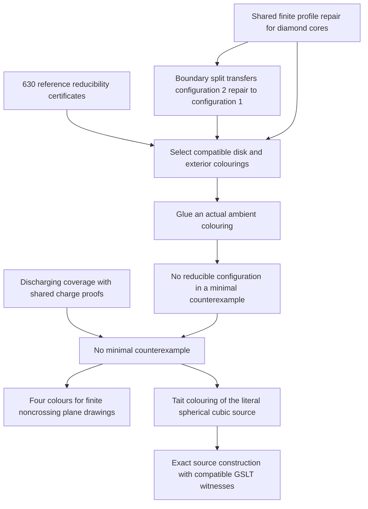

# Compositional Four Colour: proof plan and current results

Updated 30 September 2026. Original complete assembly: `b99eaf006`.
The current assembly additionally consumes a shared joint-profile certificate
for the diamond cores and a general boundary-split law transferring repair from
configuration 2 to configuration 1.

The open-piece idea in Goertzel and Fable's compositional note now has a
kernel-checked realization: graph constructions carry actual colouring
witnesses, gluing composes those witnesses, and boundary matrices count them.
A complete classical reconstruction supplies compatible choices for every
bridgeless spherical cubic source map. It also proves four-colourability for
every finite simple graph supplied with a noncrossing drawing in the plane.

The complete proof uses classical reducibility and discharging. The original
proposal to obtain a small generating base from uniform corridor geometry and
finite profiles remains a separate research programme. The present connection
is useful in both directions: the compositional library explains reconstruction,
and the classical proof supplies concrete obligations for further compression.

Start with the [completed theorem][complete], the [integration guide][package],
and the [compression ledger][ledger]. This guide connects them to the original
plan. The [long companion][companion] preserves the detailed development and
earlier attempts; its older sections are historical snapshots.

For one complete example, see [ten charge checks from three representatives](reflection-example/README.md):
semantic bounds, a general reflection theorem, and an audited replacement in
the finished proof. It illustrates discharging compression; the diamond example
below now supplies three configuration obligations from a shared finite profile
certificate and a general split transfer.

For a complete example from the corridor idea, see
[one boundary certificate for an infinite tube family](tube-example/README.md).
Every literal five-port tube of at least four rings has the four-ring boundary
relation. Strict physical shortening and GSLT composition preserve that
relation in arbitrary surrounding contexts. This reuses the earlier finite
certificate and does not depend on the classical Four Colour theorem.

A smaller interface now connects the pentagonal stopping-lobe work directly
to the shared diamond proof. A central pentagon with three consecutive
pentagonal neighbours gives an actual twelve-vertex core; the other two
neighbouring face lengths are unrestricted. One existing repair replaces
that core by four vertices and reconstructs a compatible whole-map colouring.
For the earlier six-face corona application this avoids its separate 22
terminal-colouring and nine answer-cover checks. The
[worked explanation](tube-example/README.md#using-a-smaller-shared-core)
shows why changing the interface succeeds where a stronger larger-boundary
contract fails. This is a broader local reduction, with global coverage
still to establish; it removes no further catalogue entries.

The next shared member now has [actual face recognition](tube-example/README.md#recognizing-the-mixed-diamond).
A central pentagon with consecutive neighbouring lengths five, six, five
constructs configuration 2's thirteen-vertex, seven-port core. Exact
representation transport brings its existing joint repair to the selected
region, retaining genuine colouring witnesses. Its actual exterior now has
[proved physical Kempe closure](tube-example/README.md#uniform-boundary-reconstruction).
One stack argument translates noncrossing component matchings at every finite
width, replacing the earlier six-port enumeration. Whole-component switches
reconstruct all answers through the same physical matching. The planar order
and exterior connectivity are derived for the mixed diamond, allowing repeated
attachment vertices. The [strict reduction](tube-example/README.md#strict-reduction-of-the-mixed-diamond)
now replaces that core by a five-vertex path, preserving the bridgeless
spherical cubic class and removing eight vertices in total. Restricting a
colouring of the smaller map supplies the genuine exterior colouring needed
by the shared repair. Minimality therefore excludes the actual face pattern.
Six- and seven-port reductions now consume the same map-preservation law.
No fresh colouring certificate is introduced; broader geometric supply
remains the next obligation.

Configuration 4 now has an [actual coupled-wiring strict reduction](tube-example/README.md#the-coupled-eight-port-wiring).
Its repair needs a joint contraction trace. Two free wires and two cubic
vertices joined by an edge realize exactly that contract. The central edge
retains the shared choice that separate insertion summaries lose. At an
exact embedded occurrence, normal form now derives wire separation and
physical Kempe closure of the actual exterior. Colouring the smaller wiring
reconstructs the original map, with twelve fewer vertices in the smaller
graph. The internal hexagon and an eight-port cut lemma supply the exterior
connectivity needed by this argument. The smaller graph's ambient class is
now proved: two different extensions of a hypothetical separating cut
rule out a new bridge, and the complete ordered seam preserves Euler
characteristic. Minimality supplies the smaller graph's colouring.
The four face lengths now construct every internal operation, and joint
dart transport plus a cyclic-cut argument force fourteen distinct vertices.
The outgoing-port condition is now derived as well. A hidden chord would
leave six genuine ports, separated by a cyclic-interval invariant into two
face orbits. The actual spherical embedding and connected exterior require
one orbit. Thus the four face lengths supply the exact occurrence and the
strict reduction, without an additional endpoint check.
The independent replay starts from face lengths and checks 1,424 rooted
patterns in 137 saved fullerene maps; all pass the outgoing-port check and
give connected, spherical, bridgeless replacements. This finite evidence is
separate from the theorem; the fixtures' internal-six connectivity is not
certified. Global coverage remains open.

A first [shared geometric supply law](tube-example/README.md#geometric-supply-from-pentagonal-neighbour-density)
now connects all three reductions. On a five- or six-sided face, three
pentagonal neighbour incidences force two positions separated by one edge.
The resulting edge has pentagonal flanks, and its two incident face lengths
select the six-, seven- or eight-port diamond. Counting these incidences
proves occurrence below 56 vertices in spherical cubic all-five/six maps.
Under the existing normal-form hypotheses, the selected pattern has its
certified strict reduction. The minimal-counterexample consumer uses the
smaller map's colouring and the shared repair, independently of the complete
Four Colour theorem. This establishes coverage for a bounded geometric
class; it replaces no further original configuration certificate.
Independent replay finds a diamond containing each of 1,489 odd closing
seams in the 137 saved small maps. Larger Goldberg controls have no such
diamond, so broader supply remains a substantive obligation.

The [geometric seam result](tube-example/README.md#recognizing-compatible-seams-in-actual-graphs)
now derives compatibility between consecutive recognized rows. Their actual
hexagonal seam faces force the port matching to be a cyclic translation.
Accumulating those offsets now assembles the entire recognized strip as a
literal tube, with exact exterior sewing. A five-port strip of five or more
rows reduces to four inside the original map's class, preserving all exterior
edge colours during reconstruction. The minimal-counterexample bound improves
from the earlier coarse 446,403 to four rows; extra connected-shore hypotheses
are unnecessary. Suitable alternating-row supply and width control remain
explicit geometric tasks. No further catalogue certificate is removed.

The next row is now supplied by the [hexagonal collar theorem](tube-example/README.md#constructing-a-row-from-its-surrounding-faces).
From one recognized row, edge reversal and rotation derive the next vertices;
hexagonal seam geometry proves they are distinct. Short output-port faces
then give the complete next row and compatible colouring reconstruction.
In any finite map with only pentagonal/hexagonal faces, these extensions
terminate at an actual pentagonal seam. In a least counterexample, a supplied
five-port row reaches one within three extensions. Initial row supply,
reductions at those pentagonal stops and changing widths remain coverage tasks.

The [alternating-cycle recognition theorem](tube-example/README.md#recognizing-the-initial-row)
now derives the initial row's interior and complete interfaces from a simple
cycle and its alternating local turns. It works at every width at least two.
Independent tests find width-10 and width-15 rows in the two Goldberg examples
that had no five-port row. This advances geometric recognition; existence of
a suitable cycle and a reduction effective at its width remain open.

The [alternating-walk lobe theorem](tube-example/README.md#when-the-alternating-walk-crosses-itself)
now supplies a simple cycle segment even when the full orbit crosses itself.
It retains the actual internal operations and constructs connected facial
shores, leaving one closing transition unrestricted. Independent checks find
a 30-vertex fullerene with no simple complete orbit. This replaces the proposed
universal simple-orbit step with a concrete task: derive a colouring and
reduction contract that includes the marked closing transition.

The [marked cycle contraction law](tube-example/README.md#the-information-a-cycle-contraction-must-retain)
now proves its cycle-colouring component. At every length, merging adjacent
ports commutes with taking the boundary colours; reconstruction is exact
when the retained seam colour passes one explicit guard. Forgetting that
guard fails on a kernel-checked four-cycle. This develops the boundary-algebra
part of the plan. A strict embedded reduction is now available for the
pentagonal eleven-lobe family below; arbitrary stopping lobes still need
a suitable operation and reconstruction contract.

The [pentagonal lobe patch](tube-example/README.md#from-one-seam-to-a-joint-patch-repair)
now supplies a positive joint repair beyond the cycle alone. Its literal dual
disk has six boundary vertices and six interior vertices. Lean proves that
every Kempe-closed exterior with a proper zero-sum six-port trace has a trace
realized by an actual colouring of this disk. This follows the lobe geometry:
an independent program recognizes the same pentagon-plus-eleven-cycle patch
in 29 supplied maps. The boundary proof retains nine finite answer-cover
checks and 22 terminal witnesses. A literal sixteen-vertex cubic tangle now
receives these colouring witnesses with the exact six-port order, then glues
to compatible exteriors. The new physical boundary bridge transports one
common noncrossing Kempe-component matching into Gonthier's chromograms and
reconstructs every permitted answer through that same matching. Cubic cut
parity supplies the required input equation. The patch now glues starting
from any proper exterior colouring under physical noncrossing, with an
embedded spherical-map closure theorem available for cyclic six-port cuts.
This gives the operational and reference representations an exact common
consumer. A chosen four-vertex tree now supplies a kernel-checked strict
replacement. In every connected exterior, it preserves the source's connected
bridgeless spherical cubic class, removes twelve vertices and preserves
exterior cofaciality. Under physical noncrossing, a colouring of the smaller
map reconstructs to a colouring of the original. Vertex minimality supplies
that smaller colouring. The proof retains the exterior's coupled choices and
uses no complete Four Colour theorem or catalogue reducibility certificate.
The embedded consumer now derives noncrossing from spherical geometry for
an exact recognized occurrence with connected exterior. It transports the
patch's return order, accounts for the opposite exterior orientation and
reconstructs the original ambient map. Recognition consists only of local
vertex, dart, port and rotation correspondences. In a minimal counterexample,
exterior connectedness now follows without distinct attachment vertices.
The patch contains a cycle; a disconnected exterior with six ports could
only have two isolated vertices. Euler and minimum face size leave at least
four exterior vertices. Exact local recognition therefore suffices for the
strict reduction and contradiction. The two-cycle recognition theorem below
now constructs the required correspondence. Broader supply and coverage
remain open. No further original certificate is removed. The [worked reduction](tube-example/README.md#from-one-seam-to-a-joint-patch-repair)
separates this theorem from the 406 independent tests of fourteen tree shapes.

One part of recognition now has a uniform geometric explanation, valid at
every cycle length. [Cycle incidence and boundary orientation](tube-example/README.md#recognizing-a-cycle-from-its-graph-incidence)
start from distinct cyclically adjacent graph vertices and an outward spoke
at each vertex. Cubicity reconstructs the complete local dart carrier.
In a spherical map with connected complement, a face-side invariant forces
all local turns to agree, and computes the exact cyclic port return. Rotation
and return order retain the same global orientation choice. This derives
geometry needed for the inner pentagon without enumerating its 32 rotation
assignments. The [eleven-lobe spoke-order theorem](tube-example/README.md#forcing-the-pentagons-spoke-order)
now derives the attachment order as well. Given disjoint inner and outer cycles,
all five inner spokes at the five inward outer positions, and the alternating
outer turns, the matching must be a cyclic shift or reflected shift. Its
direction is the same choice that governs the inner rotations. The closing
gap's extra face step is included. The [full geometric consumer](tube-example/README.md#reducing-the-actual-two-cycle-family)
now reindexes the inner cycle by this shared witness and constructs the
complete sixteen-vertex patch isomorphism. Every edge, rotation and exposed
port is preserved. Under minimum face size five and cyclic edge-connectivity
at least four, the actual map reduces by twelve vertices, with colouring
reconstruction. Minimality supplies those bounds. This completes recognition
and reduction for the stated two-cycle family. Its occurrence in more general
stopping lobes, wider families and coverage remain open. No additional
catalogue certificate has been removed.

The [six-face construction](tube-example/README.md#constructing-the-lobe-from-its-neighbouring-faces)
now supplies that two-cycle arrangement. Start at a pentagon adjacent to
four pentagons and one hexagon. Actual face traversal determines both
cycles, all outer turns and the shared spoke matching. Distinctness of the
sixteen traced vertices is now proved: the same rotation or edge reversal
transports a hypothetical collision to a local contradiction. One general
soundness theorem interprets the finite check in any triangle-free target
graph. Cyclic connectivity also rules out every extra outer chord, since
each would consume two of the six available ports. Minimality supplies the
ambient conditions. The actual face pattern therefore gives a twelve-vertex
strict reduction with genuine colouring reconstruction; neither distinctness
nor inducedness is supplied as an extra local premise.

This completes recognition and reduction for the pattern in arbitrary
qualifying exteriors. The 720 ordered collision/phase checks are recorded
separately from the retained colouring checks. A finite replay finds 76
occurrences in the same 29 maps as the earlier selected lobes; it supplies
examples, not global coverage. The next task is to extend the joint repair
to broader patterns and integrate replacements into the complete proof.

The [diamond insertion example](diamond-example/README.md) connects the local
insertion idea to actual configurations 1, 2 and 4. Their graphs, cyclic orders,
ordered rings, specified contracts and both colouring branches are now proved
in Lean. A GSLT
reconstruction route covers every colouring of configuration 4. The joint
profile law now provides a common finite descent for all three cores. The
complete proof consumes the new configuration-2 and configuration-4 repairs,
and transfers the former to configuration 1. All three original certificate
dependencies are absent. The shared rank uses joint available-colour sets and
boundary length. A structural single-chord exchange theorem now answers every
exterior for 71 of its 100 nonterminal representatives. A shared two-ear law
handles another 24. Joint anchor projection handles the final five, so the
local proof no longer uses the original chromogram-cover checker. The two-ear
rule retains simultaneous exchanges through the same exterior: its six active
ports can have arbitrarily many fixed-colour ports between them. The mask-transport
theorem has no width bound; the two-ear fact is checked once for the finite
six-active-port skeletons. Joint-profile ranks, partner targets and 216 local
ear-pair classifications remain finite data, as do 44 projected joint-anchor
classifications. The projection keeps the complete chord masks at selected
anchors, including their aliases, and forgets unobserved chords. Its general
reconstruction law retains the same exterior. This is a finite core proof
using shared boundary laws; no case-free broader core theorem is asserted.
A broader core-family theorem and geometric coverage remain open.

A bounded [replacement experiment](diamond-example/README.md#testing-a-different-strict-replacement)
now sharpens that task: 90,651 generated smaller disks that retain the eight
boundary vertices each meet the same abstract Kempe obstruction for configuration
4. The first longer fan has the same outcome with its own obstruction. This is
checked program evidence with an explicit enumeration limit. It directs the
next common core argument toward the joint choices retained by the successful
contraction, beyond separate support tests for smaller interiors.

## The nearest completed version of the plan

The July *Compositional Proof Note* organizes the argument into three levels.
The following translation preserves that organization while making the changed
mathematics explicit.

| Original level | Completed component | What changed |
| --- | --- | --- |
| **0. Strict descent:** a smaller obstruction contradicts minimality. | [`ClassicalAssembly.no_embedded_reduction`][assembly] obtains a colouring of a smaller contracted map and reconstructs an actual colouring of the original. | Classical unavoidability supplies an applicable reducible configuration. |
| **1. Construction:** operations generate the relevant objects and preserve the property. | [`SourceConstructionGSLT.class_represented`][source] encodes every source map exactly; `CompositionalComplete.supported_source_construction` supplies a compatible colouring history. | The construction language permits unbounded interfaces. This is not a proof that the manuscript's proposed small set of reductions generates every target. |
| **2. Open semantics:** gluing becomes relational composition and matrix multiplication. | [`OpenTangleWitnessComposition.serialEquiv` and `count_serial`][gluing] identify the actual colouring fibres and their counts. | Finiteness is available at a specified interface. No globally finite image of exact counting matrices is asserted. |

Coverage and composition answer different questions: where can a reduction
be applied, and how do its colouring witnesses fit the surrounding graph?
The completed repair uses classical coverage and compositional reconstruction.
This develops the note's invitation to find compositional structure inside
the classical proof; it does not turn its catalogue into a small generating
base or establish a finite-image monoidal functor for the entire proof.

The complete dependency chain is:

For each classical reduction, [`EmbeddedReconstruction`][reconstruction]
exposes a two-step GSLT route: select compatible assignments, then glue them.
`reconstruct` produces an explicit function colouring the original hypermap;
`routeWitness` and `route_output` identify its operational meaning. The
minimal-counterexample theorem consumes that reconstruction. Selection uses
classical choice; an executable sequence of Kempe moves has not been extracted.

The four completed endpoints in namespace `FourColor.CompositionalComplete`
are `fourColorTheorem`, `colorable_of_planeDrawing`,
`supported_source_construction`, and `supported_source_sweep`.
The drawing theorem includes empty and disconnected graphs and isolated
vertices. Its drawing data consist of distinct vertex positions and
noncrossing injective edge paths, with no colourability assumption. The source
construction retains actual vertices, edge identities and cyclic order,
including parallel edges. `supported_source_sweep` supplies compatible choices
for any complete valid vertex order; it does not extend every partial choice.

## The mathematical core to retain

For a piece `P` and boundary assignments `x, y`, let `W(P; x, y)` be its type of
colouring witnesses. Literal serial gluing gives a bijection

\[
W(P;Q;x,z) \simeq \coprod_y W(P;x,y)\times W(Q;y,z).
\]

Taking nonemptiness gives composition of boundary relations. Taking finite
cardinality gives matrix multiplication. This explains why support, counts,
and witnesses are related but different semantics: equal support permits
existence-preserving replacement even when colouring counts differ.

For reduction from an original piece `P` to a smaller piece `Q`, the useful
direction is `support(Q) ⊆ support(P)`. A colouring of the smaller graph then
provides a seam word that can be realized inside `P`. The generic
[context replacement theorem][gluing] retains the chosen exterior colouring.
Classical Kempe reconstruction can first select a different compatible
exterior colouring; it need not preserve the initially supplied contracted
colouring pointwise. Embedding conditions and strict size decrease remain
separate geometric obligations.

The same distinction applies to histories. The theorem sought is
“there exist compatible choices along this complete construction.” It is
stronger than merely constructing the graph and weaker than asking every
current choice to survive every next step. [`VertexCodeTrace.Trace.support_exact`][trace]
and the [GSLT adapter][vertex] prove that these choices describe the colourings
of the literal constructed graph.

The generic [relational route library][relations] proves witness composition,
replacement inside serial contexts, and composition of backward viability.
It makes the compatibility obligation explicit; it does not supply missing
choices by calling the system a fibration.

## How the research reached this point

| Stage | What survives in the current mathematics |
| --- | --- |
| **v23: annular algebra and Kempe execution** | Local purification and boundary algebra have checked results; several proposed peeling and execution bridges needed stronger hypotheses. Spanning an algebraic space and executing a physical Kempe history are distinct obligations. The [historical audit][v23] records the precise distinctions. |
| **Goertzel/Fable: corridors, Count and pumping** | Exact gluing, support composition, physical splicing and finite reflection at a supplied width are reusable. Global corridor or bounded-width supply was not established by the proposed defect argument. |
| **Literal constructions and geometry** | Source traces actually construct the given map. Facial sweeps, contour boundaries, curvature laws and tube replacements connect semantic operations to embedded graphs. |
| **GSLT witnesses and representation transport** | Colouring choices compose along routes, survive certified replacements and transfer between graph layouts. A MeTTa premise-engine application uses the same theorem. |
| **Classical reconstruction and compression** | The complete theorem now consumes the classical catalogue through witness reconstruction. Shared discharging lemmas replace 231 independent computations in that complete proof. |

This changes the original playbook's last two phases. The transfer engine
remains useful, but universal corridor supply is no longer a premise of the
completed baseline. Assembly obtains coverage from classical discharging.
Uniform tube, support and Kempe lemmas become candidates for replacing parts
of that baseline, with every replacement measured.

## Reusable results and where they fit

| Result | Mathematical content and present role |
| --- | --- |
| [Open-tangle witness composition][gluing] | Bijection of gluing witnesses, counting law and replacement preserving exterior witnesses. The reusable semantic foundation. |
| [Exact source constructions][source] | Structural source coverage and equivalence between route support and literal Tait colourability. Consumed by the complete construction endpoint. |
| [Hypermap transport][transport] and [source Tait bridge][tait] | Preserve the required permutations and colouring data across the classical and source representations. Consumed by the completed endpoints. |
| [Graph representation GSLTs][representations] | Six layouts share simple-graph meaning; conversion paths preserve actual vertex colourings, boundary constraints and counts. Query implementations can have different primitive step counts. These adapters do not retain multiedge identity or an embedding unless separately supplied. |
| [Zigzag tube compression][tubes] and [physical replacement][tube-geometry] | For circumference `k ≥ 3`, support stabilizes by `2k(k−1)` rings. At circumference five, the [finite-certificate integration](tube-example/README.md) sharpens the physical normal form from forty rings to four. GSLT chains compose the replacements in arbitrary contexts. This is a family theorem, not coverage of all source maps or a removed classical configuration. |
| [Facial sweeps][sweeps] and [boundary changes][face-boundary] | Construct actual face-addition histories and prove exact contour updates. Adding a face of length `l` changes boundary degree imbalance by `l−6`. These results support geometric research; the complete assembly currently reuses the reference discharging proof. |
| [Kempe channel recomposition][kempe] | Computes the changed channels by composing connectivity through retained internal attachments. External boundary mates alone are insufficient. |
| [Finite physical fork code][fork] | Exact finite reflection for supplied decompositions. Its usefulness for a new independent proof still requires an adequate width supply and the corresponding base audit. |
| [Boundary-triangle alternatives][alternatives] | Four-colourings split exactly into old-graph and contracted-graph branches. The [diamond instances](diamond-example/README.md) retain actual graphs, cyclic orders and rings, and reconstruct every target colouring through GSLT. The coupled boundary repair replaces configuration 4’s certificate. A general split law transfers repair from configuration 2 to configuration 1; wider family transport remains open. |
| [MeTTa premise routes][metta] | A verified consumer outside Four Colour: `deduplicate_freshness_iff` transports compatible premise answers through surrounding routes. A shared-binding counterexample records why separate satisfiability is insufficient. |

Adjacency matrices in the representation library encode graph incidence.
Boundary transfer matrices encode colouring counts. Changing one graph layout
does not automatically prove a fact about the other kind of matrix.

## What the obstructions actually rule out

Finite syntax does not imply finite semantic state. Repeated boundary *types*
do not justify deleting a segment: deletion must also preserve the relevant
relation and geometry. The [branching obstruction][branching] rules out the
specified bounded-atom, bounded-interface presentations by actual graph pieces;
it is not an impossibility theorem for every graph grammar or readable proof.

Exact transition-path counts can grow even when support repeats.
[Tube counting growth][growth] separates those assertions in the specified
local-ring system. A finite profile used for pumping therefore needs
a proved quotient appropriate to the property being preserved.

The [five-port Kempe support model][pentagon] admits a nonempty language
avoiding the pentagon's extending words. Abstract Kempe closure alone cannot
exclude that language. This does not prove that a planar pentagon exterior
realizes it. The conjecture that the relevant pentagon complements realize
more than 30 of the 60 parity-allowed words remains a research question; finite
search evidence is not a universal theorem.

None of these results establishes that a human-readable proof is impossible.
They specify hypotheses that a shorter proof must supply or replace.

## Compression achieved, and the next proof obligation

| Quantity | Current checked result |
| --- | --- |
| Catalogue entries retained / removed | 633 / 0 |
| Independent discharging checks at arities 9–11 | 11,363 → 11,132: 231 replaced |
| Separate finite input identities or classifications | 218, counted separately |
| Discharging-rule labels retained | 32 |
| Reference configuration certificate dependencies retained / replaced | 630 / 3 |
| Uniform repair transport | One split law: configuration 2 supplies its own repair and configuration 1's; one arbitrary-width matching codec reconstructs all chromogram answers through the same physical components |
| Uniform contextual family | All three diamond repairs extend through arbitrarily many retained-edge ears, with actual GSLT witnesses |
| Geometric corridor reduction | Actual hexagonal row chains assemble as literal tubes; five-port strips reduce to four rows, preserving the map class and exterior colours |
| Geometric successor supply | Hexagonal seam faces force distinct candidate vertices and construct the complete next row under short output-face hypotheses; finite growth reaches a pentagon, within three extensions at width five in a minimal counterexample |
| Geometric cycle supply | Every alternating trajectory supplies a simple cycle segment and connected facial shores; its embedded closing operation remains open |
| Cycle boundary contraction | One marked-seam law reconstructs literal cycle colourings at every length; forgetting the seam guard fails on a kernel-checked four-cycle |
| Pentagonal lobe reduction | A pentagon with neighbours of lengths 5,5,5,5,6 supplies the complete local recognition and a twelve-vertex reduction. Noncollision, chord exclusion and exterior conditions are derived; broader supply and coverage remain open. Nine finite answer checks remain |
| Corona geometric separation | One operation-preservation theorem interprets 720 ordered collision/phase checks in every triangle-free realization; at most six simultaneous operations per case. These are additional geometric checks, with no colouring-certificate saving claimed |
| Common finite core explanation | Joint-profile descent for configurations 1, 2 and 4; 92 ranked types, 236 representatives, 291 answers |
| Original chromogram-cover obligations | 100 → 0: single chords handle 71 representatives, coupled ears 24, and joint anchors 5 |
| Retained local classifications for the two-ear rule | 216 disjoint-ear pair checks; the six-active-port planar fact is checked once |
| Retained joint-anchor classifications | 44, using three shared signature sets of sizes 7, 10 and 10 |
| Finite matching translations replaced | Six-port matching enumeration replaced by a proof for all finite widths; five-port cyclic-arc enumeration replaced by uniform cyclic arithmetic |
| Mixed-diamond strict reduction | The actual thirteen-vertex core is replaced by a five-vertex tree: net decrease eight, ambient class preserved, and genuine colouring reconstructed using the shared repair |
| Shared replacement geometry | One theorem for arbitrary finite interfaces preserves the map class from equal ordered returns and Euler mass, connectedness and boundary-essentiality; six- and seven-port consumers are checked |
| Coupled eight-port strict reduction | Four face lengths and spherical normal form construct the complete ordered occurrence, including all eight outgoing ports. The coupled operation gives a strict reduction by twelve vertices and genuine colouring reconstruction; broader supply and coverage remain open |
| Uniform broader core reduction and geometric coverage | Open |
| Runtime or artifact-size saving | Not claimed |

The 231 replacements use periodicity, reflection, exchange of paired
endpoints and shared charge bounds. Their complete consumers are checked in
[`CompleteAudit`][audit]; they are not merely lemmas beside an unchanged proof.
The audit also rejects the original unconditional theorem and 236 superseded
checker declarations. It now requires the joint-profile law and the split transfer, and
excludes the original configuration-1, configuration-2 and configuration-4
certificates from the complete endpoint dependencies. Shared reference modules still load those
old declarations;
runtime and artifact-size savings are not claimed. Declaration counts and
independent-computation savings are different metrics.

The split transfer establishes a first pair sharing one base repair. The
joint-profile certificate now gives a common finite core explanation including
the coupled configuration-4 case. Three shared boundary laws now supply all
its exterior-cover premises, with finite profile ranks and local classifications
still explicit. The next milestone is a justified broader core family and its
recognition or geometric supply, while preserving the completed theorem. The
current triangle-subdivision work connects exact two-branch colouring semantics
to the actual configurations. The integration obligations are:

1. **Proved:** configurations 1, 2 and 4 realize the two graph operations with
   their actual cyclic orders and ring coordinates. The composed equivalence
   and GSLT route cover every configuration-4 colouring. See the
   [diamond example](diamond-example/README.md).
   One interior-elimination law now describes all three actual configuration
   boundaries and reconstructs their full colouring witnesses. Its fan model
   has arbitrary lengths; extending reducibility to those lengths is separate.
2. **Proved:** the specified contracts and their boundary traces are identified in
   the same graph coordinates. The joint contraction now has an exact
   six-colour boundary formula with reconstruction. Either insertion's
   side-edge contraction alone fails the Kempe obligation, proved in Lean.
   The earlier ten-step proof established the joint repair. A shared profile
   certificate now covers all three cores, choosing both centres jointly and
   constructing the tips against that same choice. A general chord-exchange
   rule handles 71 nonterminal representatives; coupled two-ear exchanges
   handle 24 more, retaining 216 local pair classifications. Joint anchor
   projection handles the final five, retaining 44 classifications. The two-ear
   fact has six active ports; the general mask and anchor-projection proofs
   allow arbitrary width and reinsert the fixed ports.
   Its cover and input checks retain every required exterior alternative.
3. **Integrated:** the complete assembly uses the shared profile proof for
   configurations 2 and 4. Configuration 1 inherits repair from 2 via the
   general split law, with actual witness reconstruction and the validated
   contract. The audit excludes all three original certificate dependencies.
   The profile still includes boundary length, finite partner targets and
   projected signature classifications;
   this is not a proof for arbitrarily long insertion fans. The next task is
   further structural descent and a larger family with proved geometric supply.

The tube example already gives a complete physical reduction and compositional
normalization for its own infinite family. To count as a classical
configuration-check saving, it must additionally replace a dependency of the
completed assembly. That connection remains open; the independent family
result is recorded separately in the ledger.

The [diamond example](diamond-example/README.md#one-repair-through-an-unbounded-family-of-ear-contexts)
now also gives an unbounded contextual family: a triangular ear retains an old
boundary edge and adds a vertex adjacent to its ends. One theorem transfers
each diamond core's repair through any number of these operations, recovers
the intermediate GSLT colouring witnesses, and proves strict size decrease
when the ears are erased. This establishes stability of a repair under a
specified construction family. It adds no new core repair, catalogue saving,
embedded-map recognition or coverage theorem. The failed longer-fan
contraction, further uniform core descent and geometric coverage remain
research obligations. These ear consumers retain the earlier core proofs;
the new profile proof is integrated into the complete endpoint separately.

## Verification and attribution

The classical mathematics is due to Robertson, Sanders, Seymour and Thomas;
the formal development follows Gonthier and Werner through Chris Emery's MIT
Lean port, pinned at `3db71e0a786a1f19be04c5266fe3d06fed216885`.
The [source record][sources] gives provenance and licences. The contributions
here are the compositional adapters, representation and geometry bridges,
reusable witness theory, family results, and measured certificate sharing.

The [complete replay record][measurements] contains source and artifact hashes
for 818 reference modules. Their recorded frontend times total 28,891.49
seconds, including earlier pilot runs; imported Mathlib and Mettapedia builds
are outside that total. The original final integration gate took 27.174
frontend seconds and audited 124,340 imported public declarations. Only
`propext`, `Classical.choice` and `Quot.sound` occur in the audited roots.
The [joint repair record](../../../tools/fourcolor/classical/diamond-joint-repair-measurements.json)
records the later family and complete-assembly checks.
The [summary record](../../../tools/fourcolor/classical/diamond-summary-measurements.json)
records the subsequent shared elimination law and its consumed reconstruction.
The [profile record](../../../tools/fourcolor/classical/diamond-profile-measurements.json)
records the shared finite core certificate and its complete endpoint audit.
The [reusable-semantics audit][reuse-audit] separately checks the graph and MeTTa
consumers. Build instructions are in the [package guide][package].

[complete]: ../../../lean/fourcolor-classical/MettapediaFourColor/Complete.lean
[package]: ../../../lean/fourcolor-classical/README.md
[ledger]: ../../../tools/fourcolor/classical/compression-ledger.json
[companion]: ../goertzel_4cp.tex
[assembly]: ../../../lean/fourcolor-classical/MettapediaFourColor/ClassicalAssembly.lean
[source]: ../../../lean/mettapedia/Mettapedia/GraphTheory/FourColor/SourceConstructionGSLT.lean
[gluing]: ../../../lean/mettapedia/Mettapedia/GraphTheory/FourColor/OpenTangleWitnessComposition.lean
[reconstruction]: ../../../lean/fourcolor-classical/MettapediaFourColor/EmbeddedReconstruction.lean
[trace]: ../../../lean/mettapedia/Mettapedia/GraphTheory/FourColor/VertexCodeTrace.lean
[vertex]: ../../../lean/mettapedia/Mettapedia/GraphTheory/FourColor/VertexConstructionGSLT.lean
[relations]: ../../../lean/mettapedia/Mettapedia/GSLT/Core/RelationalRouteSemantics.lean
[v23]: ../../Goertzel_4cp.tex
[transport]: ../../../lean/fourcolor-classical/MettapediaFourColor/HypermapTransport.lean
[tait]: ../../../lean/fourcolor-classical/MettapediaFourColor/SourceTait.lean
[representations]: ../../../lean/mettapedia/Mettapedia/GraphTheory/Representation/README.md
[tubes]: ../../../lean/mettapedia/Mettapedia/GraphTheory/FourColor/ZigzagTubeCompression.lean
[tube-geometry]: ../../../lean/mettapedia/Mettapedia/GraphTheory/FourColor/ZigzagTubeReplacement.lean
[sweeps]: ../../../lean/mettapedia/Mettapedia/GraphTheory/FourColor/FaceRegionSweep.lean
[face-boundary]: ../../../lean/mettapedia/Mettapedia/GraphTheory/FourColor/FaceRegionStepBoundary.lean
[kempe]: ../../../lean/mettapedia/Mettapedia/GraphTheory/FourColor/Compositional/KempeChannelSplice.lean
[fork]: ../../../lean/mettapedia/Mettapedia/GraphTheory/FourColor/PhysicalForkCodeBase.lean
[alternatives]: ../../../lean/mettapedia/Mettapedia/GraphTheory/FourColor/BoundaryTriangleAlternatives.lean
[metta]: ../../../lean/mettapedia/Mettapedia/OSLF/MeTTaIL/PremiseRouteSemantics.lean
[branching]: ../../../lean/mettapedia/Mettapedia/GraphTheory/FourColor/BranchingInterfaceObstruction.lean
[growth]: ../../../lean/mettapedia/Mettapedia/GraphTheory/FourColor/GoertzelV24TubeCountGrowth.lean
[pentagon]: ../../../lean/mettapedia/Mettapedia/GraphTheory/FourColor/Compositional/PentagonKempeSupport.lean
[audit]: ../../../lean/fourcolor-classical/MettapediaFourColor/CompleteAudit.lean
[sources]: ../../../tools/fourcolor/classical/README.md
[measurements]: ../../../tools/fourcolor/classical/complete-assembly-measurements.json
[reuse-audit]: ../../../tools/fourcolor/classical/audit/ReusableSemanticsAudit.lean
