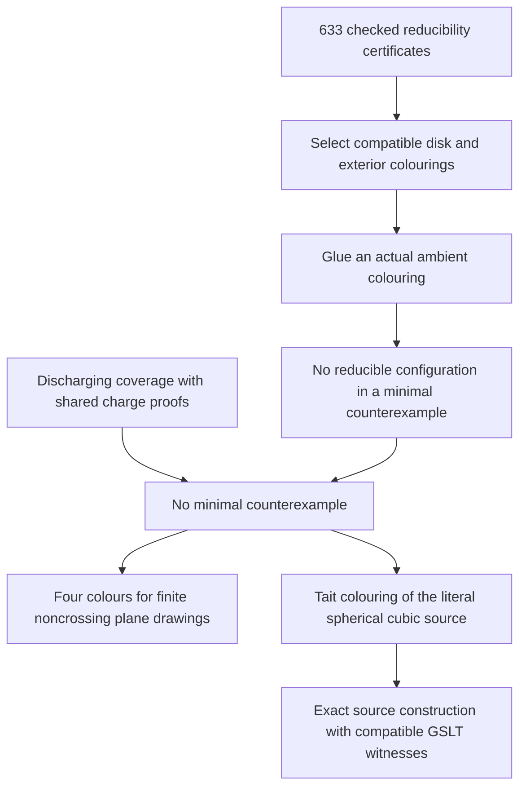

# Compositional Four Colour: proof plan and current results

Updated 29 September 2026. Complete assembly: `b99eaf006`.

The open-piece idea in Goertzel and Fable's compositional note now has a
kernel-checked realization: graph constructions carry actual colouring
witnesses, gluing composes those witnesses, and boundary matrices count them.
A complete classical reconstruction supplies compatible choices for every
bridgeless spherical cubic source map. It also proves four-colourability for
every finite simple graph supplied with a noncrossing drawing in the plane.

The complete proof uses classical reducibility and discharging. The original
proposal to obtain a small generating base from uniform corridor geometry and
finite profiles remains a separate research programme. The present connection
is useful in both directions: the compositional library explains reconstruction,
and the classical proof supplies concrete obligations for further compression.

Start with the [completed theorem][complete], the [integration guide][package],
and the [compression ledger][ledger]. This guide connects them to the original
plan. The [long companion][companion] preserves the detailed development and
earlier attempts; its older sections are historical snapshots.

For one complete example, see [ten charge checks from three representatives](reflection-example/README.md):
semantic bounds, a general reflection theorem, and an audited replacement in
the finished proof. It illustrates discharging compression; the next
configuration-family reducibility milestone remains separate.

For a complete example from the corridor idea, see
[one boundary certificate for an infinite tube family](tube-example/README.md).
Every literal five-port tube of at least four rings has the four-ring boundary
relation. Strict physical shortening and GSLT composition preserve that
relation in arbitrary surrounding contexts. This reuses the earlier finite
certificate and does not depend on the classical Four Colour theorem.

The [diamond insertion example](diamond-example/README.md) connects the local
insertion idea to actual configurations 1, 2 and 4. Their graphs, cyclic orders,
ordered rings, specified contracts and both colouring branches are now proved
in Lean. A GSLT
reconstruction route covers every colouring of configuration 4; transport of
reducibility remains the next step.

## The nearest completed version of the plan

The July *Compositional Proof Note* organizes the argument into three levels.
The following translation preserves that organization while making the changed
mathematics explicit.

| Original level | Completed component | What changed |
| --- | --- | --- |
| **0. Strict descent:** a smaller obstruction contradicts minimality. | [`ClassicalAssembly.no_embedded_reduction`][assembly] obtains a colouring of a smaller contracted map and reconstructs an actual colouring of the original. | Classical unavoidability supplies an applicable reducible configuration. |
| **1. Construction:** operations generate the relevant objects and preserve the property. | [`SourceConstructionGSLT.class_represented`][source] encodes every source map exactly; `CompositionalComplete.supported_source_construction` supplies a compatible colouring history. | The construction language permits unbounded interfaces. This is not a proof that the manuscript's proposed small set of reductions generates every target. |
| **2. Open semantics:** gluing becomes relational composition and matrix multiplication. | [`OpenTangleWitnessComposition.serialEquiv` and `count_serial`][gluing] identify the actual colouring fibres and their counts. | Finiteness is available at a specified interface. No globally finite image of exact counting matrices is asserted. |

Coverage and composition answer different questions: where can a reduction
be applied, and how do its colouring witnesses fit the surrounding graph?
The completed repair uses classical coverage and compositional reconstruction.
This develops the note's invitation to find compositional structure inside
the classical proof; it does not turn its catalogue into a small generating
base or establish a finite-image monoidal functor for the entire proof.

The complete dependency chain is:

For each classical reduction, [`EmbeddedReconstruction`][reconstruction]
exposes a two-step GSLT route: select compatible assignments, then glue them.
`reconstruct` produces an explicit function colouring the original hypermap;
`routeWitness` and `route_output` identify its operational meaning. The
minimal-counterexample theorem consumes that reconstruction. Selection uses
classical choice; an executable sequence of Kempe moves has not been extracted.

The four completed endpoints in namespace `FourColor.CompositionalComplete`
are `fourColorTheorem`, `colorable_of_planeDrawing`,
`supported_source_construction`, and `supported_source_sweep`.
The drawing theorem includes empty and disconnected graphs and isolated
vertices. Its drawing data consist of distinct vertex positions and
noncrossing injective edge paths, with no colourability assumption. The source
construction retains actual vertices, edge identities and cyclic order,
including parallel edges. `supported_source_sweep` supplies compatible choices
for any complete valid vertex order; it does not extend every partial choice.

## The mathematical core to retain

For a piece `P` and boundary assignments `x, y`, let `W(P; x, y)` be its type of
colouring witnesses. Literal serial gluing gives a bijection

\[
W(P;Q;x,z) \simeq \coprod_y W(P;x,y)\times W(Q;y,z).
\]

Taking nonemptiness gives composition of boundary relations. Taking finite
cardinality gives matrix multiplication. This explains why support, counts,
and witnesses are related but different semantics: equal support permits
existence-preserving replacement even when colouring counts differ.

For reduction from an original piece `P` to a smaller piece `Q`, the useful
direction is `support(Q) ⊆ support(P)`. A colouring of the smaller graph then
provides a seam word that can be realized inside `P`. The generic
[context replacement theorem][gluing] retains the chosen exterior colouring.
Classical Kempe reconstruction can first select a different compatible
exterior colouring; it need not preserve the initially supplied contracted
colouring pointwise. Embedding conditions and strict size decrease remain
separate geometric obligations.

The same distinction applies to histories. The theorem sought is
“there exist compatible choices along this complete construction.” It is
stronger than merely constructing the graph and weaker than asking every
current choice to survive every next step. [`VertexCodeTrace.Trace.support_exact`][trace]
and the [GSLT adapter][vertex] prove that these choices describe the colourings
of the literal constructed graph.

The generic [relational route library][relations] proves witness composition,
replacement inside serial contexts, and composition of backward viability.
It makes the compatibility obligation explicit; it does not supply missing
choices by calling the system a fibration.

## How the research reached this point

| Stage | What survives in the current mathematics |
| --- | --- |
| **v23: annular algebra and Kempe execution** | Local purification and boundary algebra have checked results; several proposed peeling and execution bridges needed stronger hypotheses. Spanning an algebraic space and executing a physical Kempe history are distinct obligations. The [historical audit][v23] records the precise distinctions. |
| **Goertzel/Fable: corridors, Count and pumping** | Exact gluing, support composition, physical splicing and finite reflection at a supplied width are reusable. Global corridor or bounded-width supply was not established by the proposed defect argument. |
| **Literal constructions and geometry** | Source traces actually construct the given map. Facial sweeps, contour boundaries, curvature laws and tube replacements connect semantic operations to embedded graphs. |
| **GSLT witnesses and representation transport** | Colouring choices compose along routes, survive certified replacements and transfer between graph layouts. A MeTTa premise-engine application uses the same theorem. |
| **Classical reconstruction and compression** | The complete theorem now consumes the classical catalogue through witness reconstruction. Shared discharging lemmas replace 231 independent computations in that complete proof. |

This changes the original playbook's last two phases. The transfer engine
remains useful, but universal corridor supply is no longer a premise of the
completed baseline. Assembly obtains coverage from classical discharging.
Uniform tube, support and Kempe lemmas become candidates for replacing parts
of that baseline, with every replacement measured.

## Reusable results and where they fit

| Result | Mathematical content and present role |
| --- | --- |
| [Open-tangle witness composition][gluing] | Bijection of gluing witnesses, counting law and replacement preserving exterior witnesses. The reusable semantic foundation. |
| [Exact source constructions][source] | Structural source coverage and equivalence between route support and literal Tait colourability. Consumed by the complete construction endpoint. |
| [Hypermap transport][transport] and [source Tait bridge][tait] | Preserve the required permutations and colouring data across the classical and source representations. Consumed by the completed endpoints. |
| [Graph representation GSLTs][representations] | Six layouts share simple-graph meaning; conversion paths preserve actual vertex colourings, boundary constraints and counts. Query implementations can have different primitive step counts. These adapters do not retain multiedge identity or an embedding unless separately supplied. |
| [Zigzag tube compression][tubes] and [physical replacement][tube-geometry] | For circumference `k ≥ 3`, support stabilizes by `2k(k−1)` rings. At circumference five, the [finite-certificate integration](tube-example/README.md) sharpens the physical normal form from forty rings to four. GSLT chains compose the replacements in arbitrary contexts. This is a family theorem, not coverage of all source maps or a removed classical configuration. |
| [Facial sweeps][sweeps] and [boundary changes][face-boundary] | Construct actual face-addition histories and prove exact contour updates. Adding a face of length `l` changes boundary degree imbalance by `l−6`. These results support geometric research; the complete assembly currently reuses the reference discharging proof. |
| [Kempe channel recomposition][kempe] | Computes the changed channels by composing connectivity through retained internal attachments. External boundary mates alone are insufficient. |
| [Finite physical fork code][fork] | Exact finite reflection for supplied decompositions. Its usefulness for a new independent proof still requires an adequate width supply and the corresponding base audit. |
| [Boundary-triangle alternatives][alternatives] | Four-colourings split exactly into old-graph and contracted-graph branches. The [diamond instances](diamond-example/README.md) now retain the actual reference graphs, cyclic orders and rings, and reconstruct every target colouring through a GSLT route. Reducibility transport remains open. |
| [MeTTa premise routes][metta] | A verified consumer outside Four Colour: `deduplicate_freshness_iff` transports compatible premise answers through surrounding routes. A shared-binding counterexample records why separate satisfiability is insufficient. |

Adjacency matrices in the representation library encode graph incidence.
Boundary transfer matrices encode colouring counts. Changing one graph layout
does not automatically prove a fact about the other kind of matrix.

## What the obstructions actually rule out

Finite syntax does not imply finite semantic state. Repeated boundary *types*
do not justify deleting a segment: deletion must also preserve the relevant
relation and geometry. The [branching obstruction][branching] rules out the
specified bounded-atom, bounded-interface presentations by actual graph pieces;
it is not an impossibility theorem for every graph grammar or readable proof.

Exact transition-path counts can grow even when support repeats.
[Tube counting growth][growth] separates those assertions in the specified
local-ring system. A finite profile used for pumping therefore needs
a proved quotient appropriate to the property being preserved.

The [five-port Kempe support model][pentagon] admits a nonempty language
avoiding the pentagon's extending words. Abstract Kempe closure alone cannot
exclude that language. This does not prove that a planar pentagon exterior
realizes it. The conjecture that the relevant pentagon complements realize
more than 30 of the 60 parity-allowed words remains a research question; finite
search evidence is not a universal theorem.

None of these results establishes that a human-readable proof is impossible.
They specify hypotheses that a shorter proof must supply or replace.

## Compression achieved, and the next proof obligation

| Quantity | Current checked result |
| --- | --- |
| Catalogue entries retained / removed | 633 / 0 |
| Independent discharging checks at arities 9–11 | 11,363 → 11,132: 231 replaced |
| Separate finite input identities or classifications | 218, counted separately |
| Discharging-rule labels retained | 32 |
| Uniform configuration-family reducibility replacing catalogue checks | None yet |
| Runtime or artifact-size saving | Not claimed |

The 231 replacements use periodicity, reflection, exchange of paired
endpoints and shared charge bounds. Their complete consumers are checked in
[`CompleteAudit`][audit]; they are not merely lemmas beside an unchanged proof.
The audit also rejects the original unconditional theorem and 236 superseded
checker declarations. Declaration counts and independent-computation savings
are different metrics.

The next research milestone is a uniform lemma replacing a family of
configuration checks while preserving the completed theorem. The current
triangle-subdivision work now connects the exact two-branch colouring semantics
to the actual diamond configurations. The integration obligations are:

1. **Proved:** configurations 1, 2 and 4 realize the two graph operations with
   their actual cyclic orders and ring coordinates. The composed equivalence
   and GSLT route cover every configuration-4 colouring. See the
   [diamond example](diamond-example/README.md).
2. The specified contracts and their boundary traces are now identified in
   the same graph coordinates. Transport reducibility through **both** colouring
   branches, retaining the
   required Kempe and planar-exterior hypotheses. A proof restricted to one
   branch is insufficient.
3. Replace the corresponding checker dependencies in the complete assembly
   and rerun its audit. Record configuration-check savings separately from
   any change to the unavoidable catalogue, which also needs coverage.

The tube example already gives a complete physical reduction and compositional
normalization for its own infinite family. To count as a classical
configuration-check saving, it must additionally replace a dependency of the
completed assembly. That connection remains open; the independent family
result is recorded separately in the ledger.

## Verification and attribution

The classical mathematics is due to Robertson, Sanders, Seymour and Thomas;
the formal development follows Gonthier and Werner through Chris Emery's MIT
Lean port, pinned at `3db71e0a786a1f19be04c5266fe3d06fed216885`.
The [source record][sources] gives provenance and licences. The contributions
here are the compositional adapters, representation and geometry bridges,
reusable witness theory, family results, and measured certificate sharing.

The [complete replay record][measurements] contains source and artifact hashes
for 818 reference modules. Their recorded frontend times total 28,891.49
seconds, including earlier pilot runs; imported Mathlib and Mettapedia builds
are outside that total. The separate final integration gate took 27.174
frontend seconds and audited 124,340 imported public declarations. Only
`propext`, `Classical.choice` and `Quot.sound` occur in the audited roots.
The [reusable-semantics audit][reuse-audit] separately checks the graph and MeTTa
consumers. Build instructions are in the [package guide][package].

[complete]: ../../../lean/fourcolor-classical/MettapediaFourColor/Complete.lean
[package]: ../../../lean/fourcolor-classical/README.md
[ledger]: ../../../tools/fourcolor/classical/compression-ledger.json
[companion]: ../goertzel_4cp.tex
[assembly]: ../../../lean/fourcolor-classical/MettapediaFourColor/ClassicalAssembly.lean
[source]: ../../../lean/mettapedia/Mettapedia/GraphTheory/FourColor/SourceConstructionGSLT.lean
[gluing]: ../../../lean/mettapedia/Mettapedia/GraphTheory/FourColor/OpenTangleWitnessComposition.lean
[reconstruction]: ../../../lean/fourcolor-classical/MettapediaFourColor/EmbeddedReconstruction.lean
[trace]: ../../../lean/mettapedia/Mettapedia/GraphTheory/FourColor/VertexCodeTrace.lean
[vertex]: ../../../lean/mettapedia/Mettapedia/GraphTheory/FourColor/VertexConstructionGSLT.lean
[relations]: ../../../lean/mettapedia/Mettapedia/GSLT/Core/RelationalRouteSemantics.lean
[v23]: ../../Goertzel_4cp.tex
[transport]: ../../../lean/fourcolor-classical/MettapediaFourColor/HypermapTransport.lean
[tait]: ../../../lean/fourcolor-classical/MettapediaFourColor/SourceTait.lean
[representations]: ../../../lean/mettapedia/Mettapedia/GraphTheory/Representation/README.md
[tubes]: ../../../lean/mettapedia/Mettapedia/GraphTheory/FourColor/ZigzagTubeCompression.lean
[tube-geometry]: ../../../lean/mettapedia/Mettapedia/GraphTheory/FourColor/ZigzagTubeReplacement.lean
[sweeps]: ../../../lean/mettapedia/Mettapedia/GraphTheory/FourColor/FaceRegionSweep.lean
[face-boundary]: ../../../lean/mettapedia/Mettapedia/GraphTheory/FourColor/FaceRegionStepBoundary.lean
[kempe]: ../../../lean/mettapedia/Mettapedia/GraphTheory/FourColor/Compositional/KempeChannelSplice.lean
[fork]: ../../../lean/mettapedia/Mettapedia/GraphTheory/FourColor/PhysicalForkCodeBase.lean
[alternatives]: ../../../lean/mettapedia/Mettapedia/GraphTheory/FourColor/BoundaryTriangleAlternatives.lean
[metta]: ../../../lean/mettapedia/Mettapedia/OSLF/MeTTaIL/PremiseRouteSemantics.lean
[branching]: ../../../lean/mettapedia/Mettapedia/GraphTheory/FourColor/BranchingInterfaceObstruction.lean
[growth]: ../../../lean/mettapedia/Mettapedia/GraphTheory/FourColor/GoertzelV24TubeCountGrowth.lean
[pentagon]: ../../../lean/mettapedia/Mettapedia/GraphTheory/FourColor/Compositional/PentagonKempeSupport.lean
[audit]: ../../../lean/fourcolor-classical/MettapediaFourColor/CompleteAudit.lean
[sources]: ../../../tools/fourcolor/classical/README.md
[measurements]: ../../../tools/fourcolor/classical/complete-assembly-measurements.json
[reuse-audit]: ../../../tools/fourcolor/classical/audit/ReusableSemanticsAudit.lean
